<div align="center">

# NODO AI

**A private memory of your meetings. Every answer points to the sentence it came from.**

<p>
  
  
  
  
  
</p>

<p>
  
  
  
  
  
</p>

<p>
  
  
  
  
  
  
  
</p>

<p>
  
  
  
  
  
</p>

<p>
  
  
  
  
  
  
  
</p>

<a href="#what-you-can-do">What you can do</a> · <a href="#how-it-works">How it works</a> · <a href="#two-ways-to-run-it">Local or Azure</a> · <a href="#a-tour-of-the-screens">Screens</a> · <a href="#quick-start">Quick start</a> · <a href="#quality-and-tests">Tests</a> · <a href="#principles">Principles</a> · <a href="#documentation">Docs</a>

</div>

NODO records meetings that everyone knows about, turns them into a searchable transcript and a knowledge graph of people, topics, decisions and actions, and lets you ask questions in English, Polish, Italian or Danish. If the meetings do not contain the evidence, NODO says so instead of guessing.

It runs in two ways with the same interface and the same API: **entirely on your computer** with local models, or **on Azure**. A local archive can be copied to Azure later.

<p align="center">
  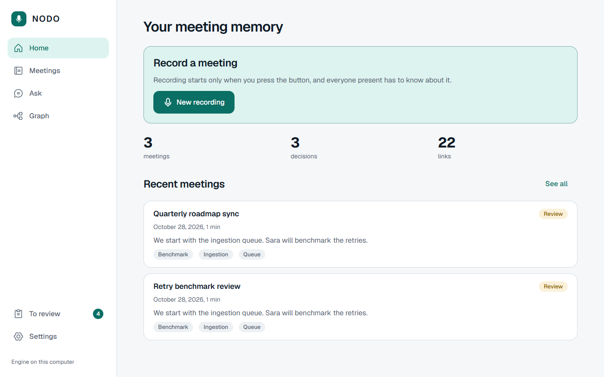
  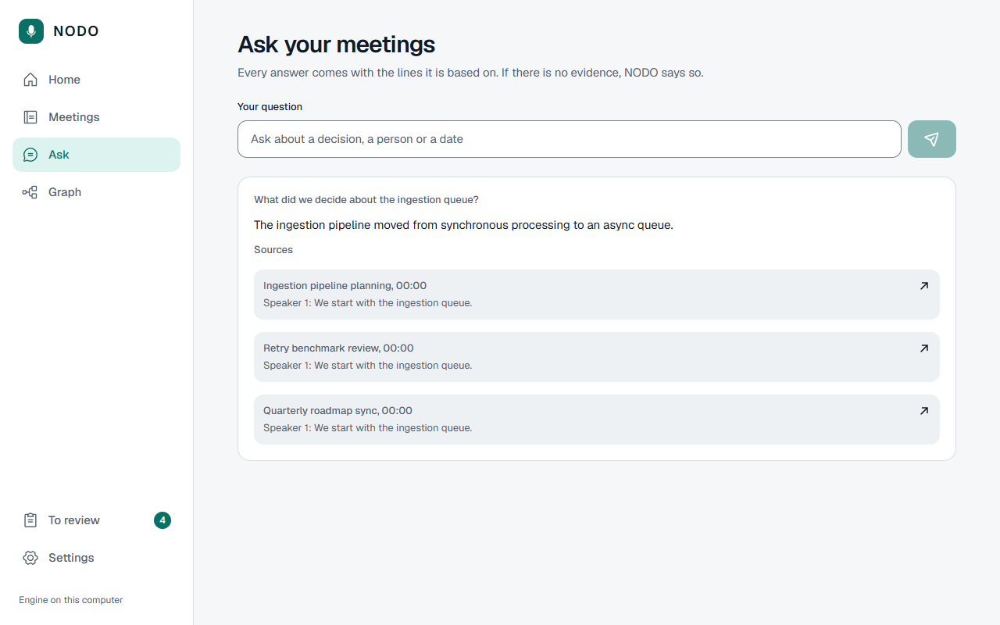
</p>

<sub>Pictures are taken from the real interface running against the local engine with stand-in models (the test setup), so the meeting text is repeated sample text. With the real models the content is yours.</sub>

## What you can do

| | |
|---|---|
| **Record** | Press a button, confirm that everyone knows, pick how long the audio is kept (7, 30 or 90 days). Recording is never hidden: the screen always shows it is live. |
| **Understand** | Transcript with speakers (S1, S2, which you can name), a summary, decisions and action items with owner and date. |
| **Ask** | Free questions, in any of the four languages. Each answer lists the quotes it is built on; click one to jump to that sentence in the transcript. |
| **Trust** | Decisions and links the system infers stay *proposals* until you approve them in the review inbox. Your decision is written to an audit trail. |
| **See** | A knowledge graph as an accessible list and as a map, with what changed (a decision replacing an older one). |
| **Own** | Export everything you have as one file, delete a meeting and its audio, text, search entries and graph entries are erased. |

## How it works

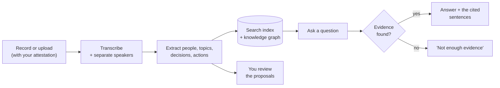

Two rules shape everything: an answer without a quote behind it is refused by code, not by prompt, and every query is filtered by who owns the meeting before anything is retrieved.

## Two ways to run it

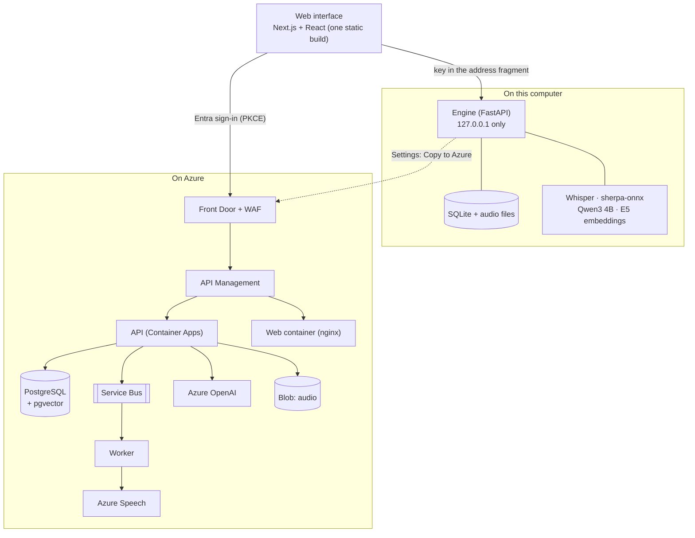

| | On this computer | On Azure |
|---|---|---|
| Interface | the same build, served by the engine | the same build, served by an nginx container |
| Data | SQLite file and audio files in `%LOCALAPPDATA%\NODO` | PostgreSQL, Blob Storage |
| Speech | Whisper medium, speaker separation with sherpa-onnx | Azure Speech |
| Language model | Qwen3 4B through llama.cpp | Azure OpenAI |
| Search | full text plus vectors in SQLite | AI Search plus pgvector |
| Sign-in | a secret created at every start, loopback only | Microsoft Entra External ID |
| Best for | privacy, one person, no cloud cost | teams, availability, a second region |

The two engines offer the same features, not the same quality: the local model is smaller, so it finds fewer decisions in a long meeting, and everything it proposes is marked as a proposal. Measurements: [docs/PERFORMANCE.md](docs/PERFORMANCE.md).

## A tour of the screens

<table>
  <tr>
    <td width="50%">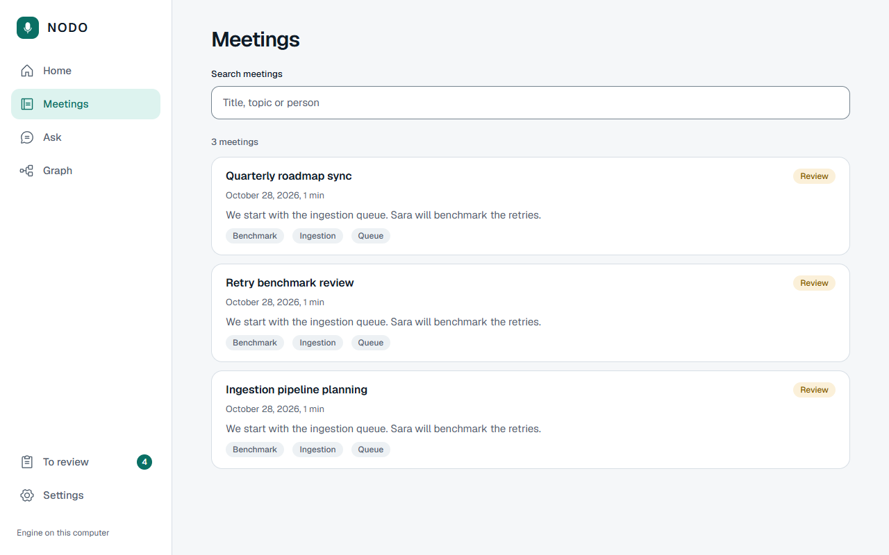<br><b>Meetings.</b> Search by title, topic or person, with accents and case ignored (<code>lodz</code> finds <code>Łódź</code>).</td>
    <td width="50%">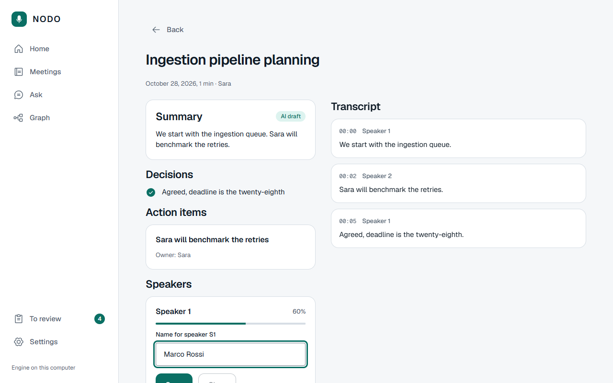<br><b>One meeting.</b> Summary, decisions, actions, speakers you can name, and the transcript with timestamps.</td>
  </tr>
  <tr>
    <td>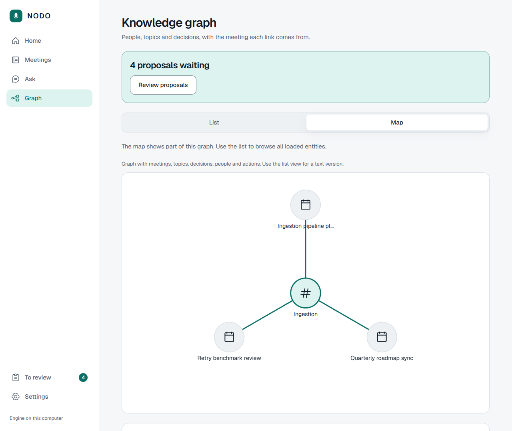<br><b>Graph.</b> A list for reading, a map for exploring. Every node is a real button.</td>
    <td>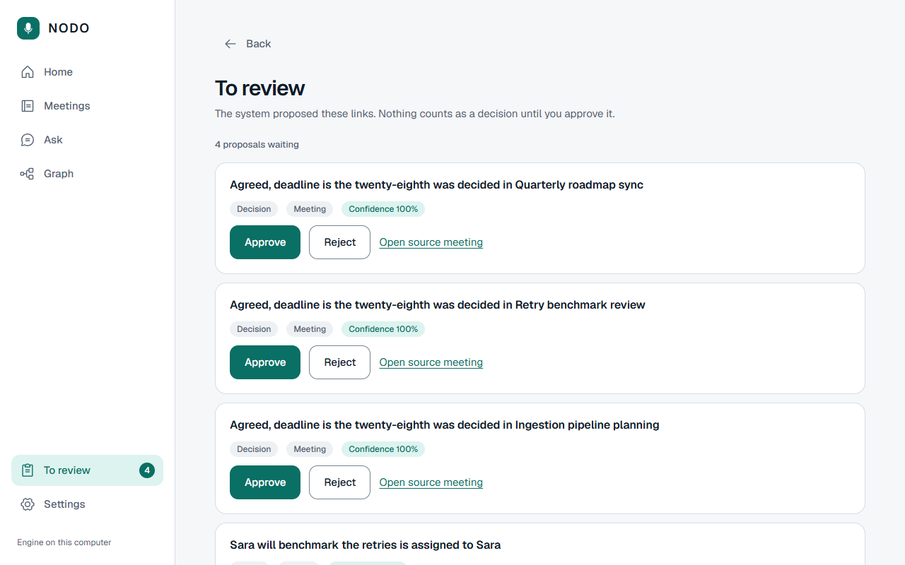<br><b>To review.</b> Each proposal in a sentence, how sure the system was, and two buttons.</td>
  </tr>
  <tr>
    <td>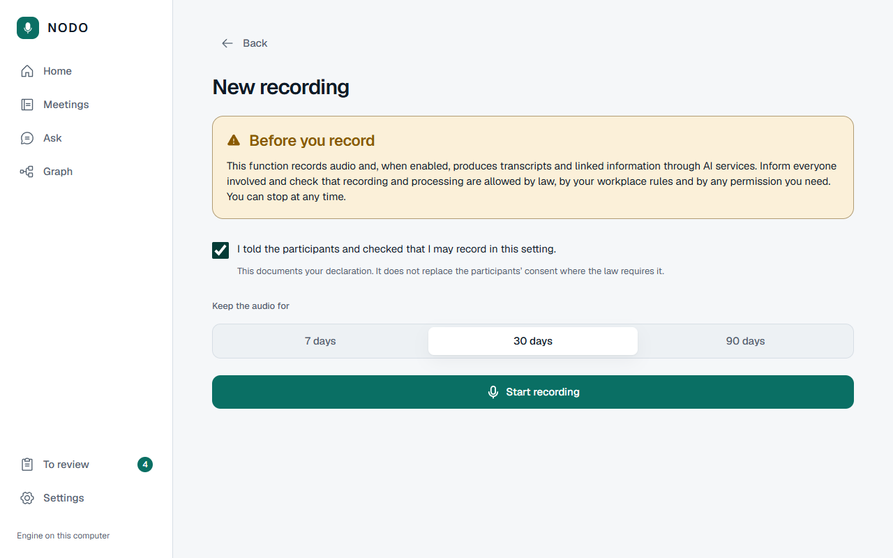<br><b>Before you record.</b> The legal notice, your attestation and how long to keep the audio.</td>
    <td>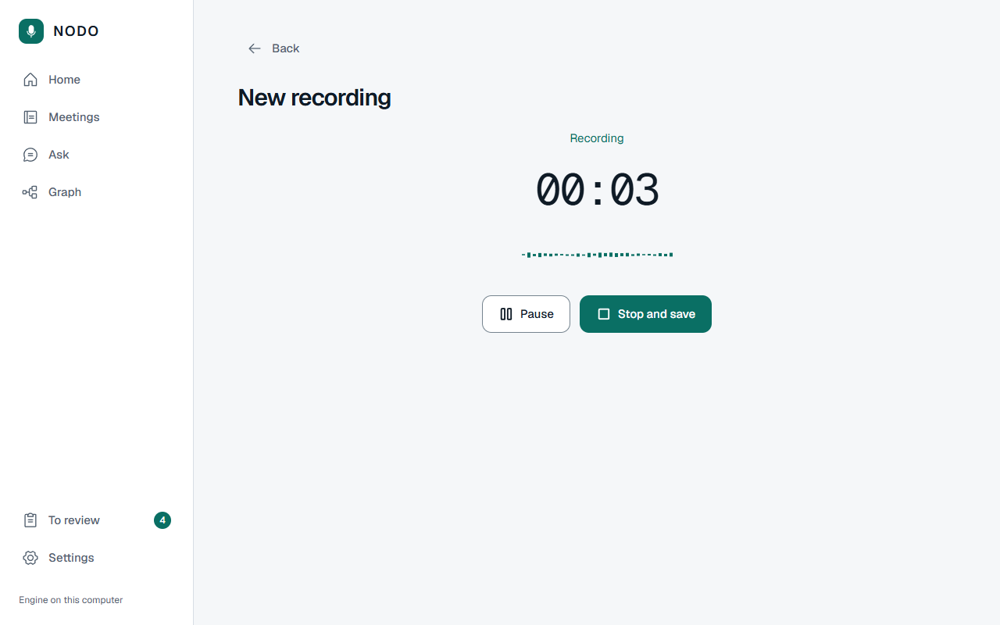<br><b>Recording.</b> A timer and a live level, pause and resume. Then upload and processing step by step.</td>
  </tr>
  <tr>
    <td>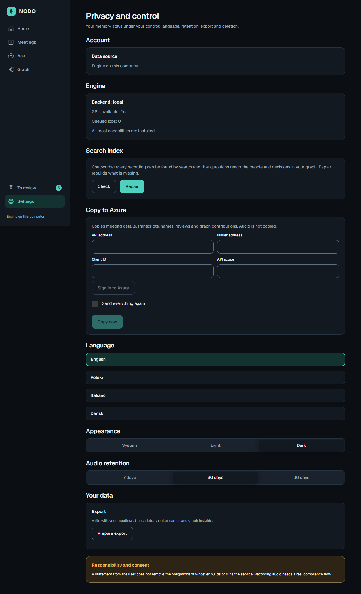<br><b>Settings.</b> Engine status, search index check and repair, copy to Azure, language, theme, export. Dark and light themes.</td>
    <td>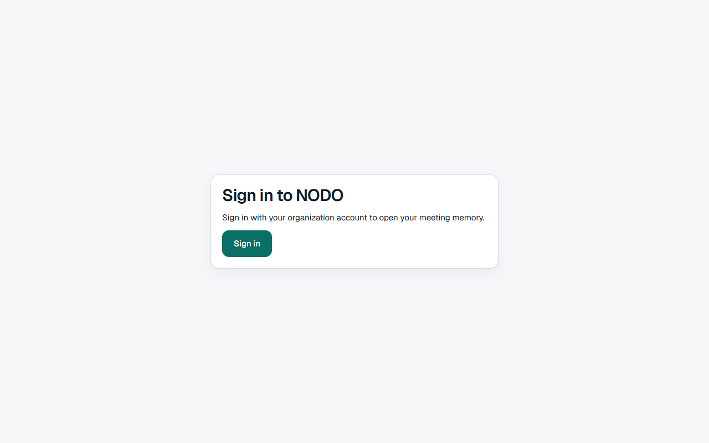<br><b>Azure.</b> The deployment asks for a Microsoft Entra sign-in; the desktop app needs none.</td>
  </tr>
</table>

<p align="center">
  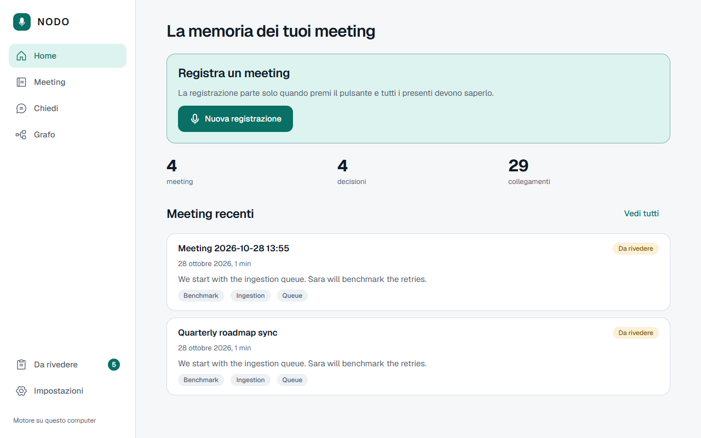
  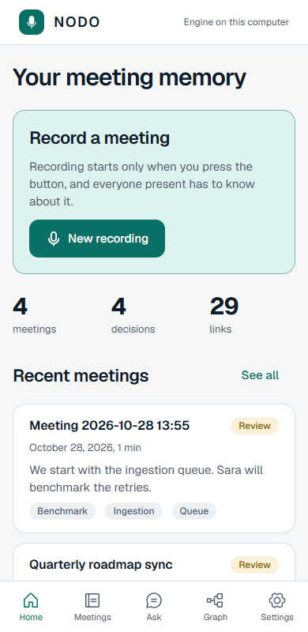
  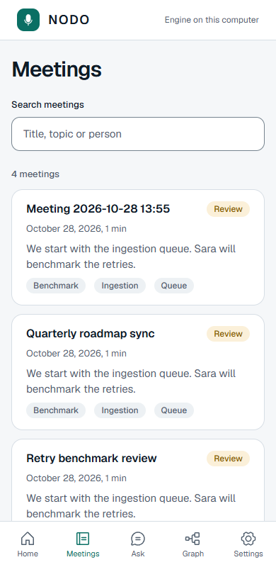
</p>

<sub>The interface is in English, Polish, Italian and Danish, and works from a phone-sized window to a desktop.</sub>

## Quick start

### Run the desktop app (Windows)

```bash
# 1. the engine
cd services/api
python -m venv .venv
.venv/Scripts/python -m pip install -e ".[dev,azure,local-models]"

# 2. the models (asks before downloading, about 5.5 GB in total)
.venv/Scripts/python ../../tools/local-setup/install_models.py
.venv/Scripts/python ../../tools/local-setup/export_embedding_onnx.py

# 3. the interface, built once
cd ../../apps/web
npm ci
npm run export:desktop

# 4. start
cd ../..
NODO.cmd
```

A window opens on your own engine. You need `ffmpeg` on the PATH and, for comfortable speed, an NVIDIA card with 6 GB. Details, troubleshooting and what is stored where: [docs/DESKTOP.md](docs/DESKTOP.md).

### Work on the web interface

```bash
# an engine to talk to, with stand-in models: nothing to download
cd services/api && .venv/Scripts/python scripts/e2e_engine.py --port 8765

# the interface with live reload
cd apps/web && npm ci && npm run dev
# open http://localhost:3000/#token=e2e-local-engine-key-0123456789-0123456789
```

More in [apps/web/README.md](apps/web/README.md).

### Work on the API

```bash
cd services/api
python -m venv .venv && .venv/Scripts/python -m pip install -e ".[dev]"
.venv/Scripts/python -m pytest
```

Local data stores for development: `docker compose -f infra/compose/docker-compose.yml --env-file infra/compose/.env.example up -d` (PostgreSQL with pgvector, Neo4j, MinIO, all bound to `127.0.0.1`).

### Deploy to Azure

Terraform in `infra/terraform` builds a basic tier (public, one region) or a professional tier (private network, Front Door and API Management, two regions). The step by step procedure with a check after every phase is [docs/FIRST-DEPLOY.md](docs/FIRST-DEPLOY.md).

### The Android app

`apps/mobile` is an Expo (React Native) client for Android with native capture: `cd apps/mobile && npm ci && npm run android` (needs a development build, see [ADR-001](docs/adr/001-react-native-native-recorder.md)).

## Repository layout

```text
apps/web/                Next.js + React interface (static export), tests, Azure image
apps/mobile/             Expo app for Android
services/api/            FastAPI /v1 contract; adapters: memory, Azure, local (SQLite, Whisper, llama.cpp); desktop launcher
packages/contracts/      OpenAPI contract shared by the API and the apps
infra/terraform/         Azure: basic and professional tiers, with plan tests
infra/compose/           Local PostgreSQL + pgvector, Neo4j, MinIO
infra/azure/             GitHub to Azure sign-in setup
eval/                    60 provenance, access and cross-language cases, runner and scorer
tools/local-setup/       Model installer for the local engine
tools/local-check/       End-to-end checks of the local engine with real models
tools/speech-bench/      Speech and speaker benchmarks (local and Azure)
tools/verify/            Container checks for the API image and the web image
tools/smoke/             Smoke test through the public entrance
tools/capacity/          Capacity model that sizes Azure from the workload
tools/diagrams/          Generators of the Azure architecture pictures
docs/                    Architecture, Azure, desktop, design, runbooks, 27 decision records
```

## Quality and tests

| Area | What runs | Command |
|---|---|---|
| Web interface | type check, lint, format, unit tests (API client, uploads, sign-in flow, recorder, mappers), production build | `cd apps/web && npm run typecheck && npm run lint && npm test && npm run build` |
| Web in a real browser | sign-in with PKCE and token renewal, recording with a microphone, upload, export, the "Copy to Azure" pop-up, accessibility checks in both themes, no content-policy violation | `npm run test:e2e` |
| API | unit and integration tests, including a real PostgreSQL for every database role and row level security | `cd services/api && python -m pytest` |
| Azure plan | `terraform validate` and plan-time tests of both tiers, API Management policies rendered and parsed | `terraform -chdir=infra/terraform/modules/nodo test` |
| Images | the API image and the web image started the way Azure starts them | `tools/verify/container-check.sh`, `tools/verify/web-container-check.sh` |
| Answer quality | golden set of 60 cases, with provenance and access control | [eval/README.md](eval/README.md) |

Regenerate the pictures of this page with `NODO_SCREENSHOTS=1 npx playwright test e2e/local.screenshots.spec.ts e2e/cloud.screenshots.spec.ts` in `apps/web`.

## Principles

- **Nothing hidden.** Recording needs a visible action and your declaration that everyone knows. The declaration is signed and kept; it does not replace consent where the law requires it.
- **Evidence or silence.** An answer is shown only with the quotes it comes from. "Not enough evidence" is a normal result, not an error.
- **Humans decide.** The system proposes, you approve. Decisions stay proposals until you do.
- **Your data stays yours.** Access is checked before retrieval, deletion removes audio, text, index and graph entries, and the search index and graph can always be rebuilt from the archive.
- **Same behaviour in both worlds.** One API contract, two engines, one test suite.
- **Accessible.** The graph list is primary and the map is secondary, everything works from the keyboard, nothing relies on colour alone, motion respects the system setting.

## Documentation

| Topic | Where |
|---|---|
| Run the desktop app, models, data folder, troubleshooting | [docs/DESKTOP.md](docs/DESKTOP.md) |
| Web interface: decision and how it is built | [apps/web/README.md](apps/web/README.md), [ADR-027](docs/adr/027-nextjs-web-interface.md) |
| The API contract | [docs/API-V1.md](docs/API-V1.md), [packages/contracts](packages/contracts) |
| Architecture | [docs/ARCHITECTURE.md](docs/ARCHITECTURE.md), C4 views in [docs/architecture](docs/architecture) |
| Azure design, deployment, recovery | [docs/AZURE-ARCHITECTURE.md](docs/AZURE-ARCHITECTURE.md), [docs/FIRST-DEPLOY.md](docs/FIRST-DEPLOY.md), [docs/RUNBOOKS.md](docs/RUNBOOKS.md), [docs/CAPACITY-MODEL.md](docs/CAPACITY-MODEL.md) |
| Compliance and security | [docs/COMPLIANCE.md](docs/COMPLIANCE.md), [docs/SECURITY-BACKLOG.md](docs/SECURITY-BACKLOG.md) |
| Measurements and benchmarks | [docs/PERFORMANCE.md](docs/PERFORMANCE.md), [local performance scorecard](docs/LOCAL-PERFORMANCE-SCORECARD.md), [benchmark plan](docs/BENCHMARK-PLAN.md) |
| Real-time voice (proposed) | [docs/VOICE-REALTIME-ARCHITECTURE.md](docs/VOICE-REALTIME-ARCHITECTURE.md) |
| Design system | [docs/DESIGN.md](docs/DESIGN.md) |
| Product blueprint (Italian) | [docs/product](docs/product) |
| Why things are the way they are | [docs/adr](docs/adr) (27 decision records) |

## Status

The engine works end to end on both backends: record, transcribe, separate speakers, extract, graph, ask, erase, and copy to the cloud. Azure is untested against a live subscription. The Terraform, the images, the sign-in flow and the web interface are checked as described in [Quality and tests](#quality-and-tests); what only a real subscription can show is listed in [docs/AZURE-ARCHITECTURE.md](docs/AZURE-ARCHITECTURE.md), section 14.
