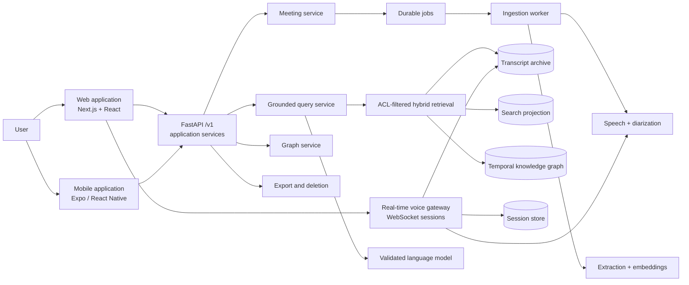
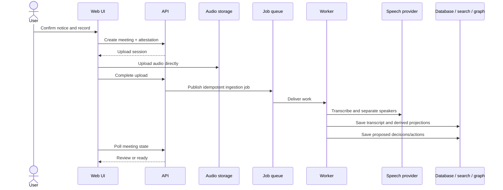
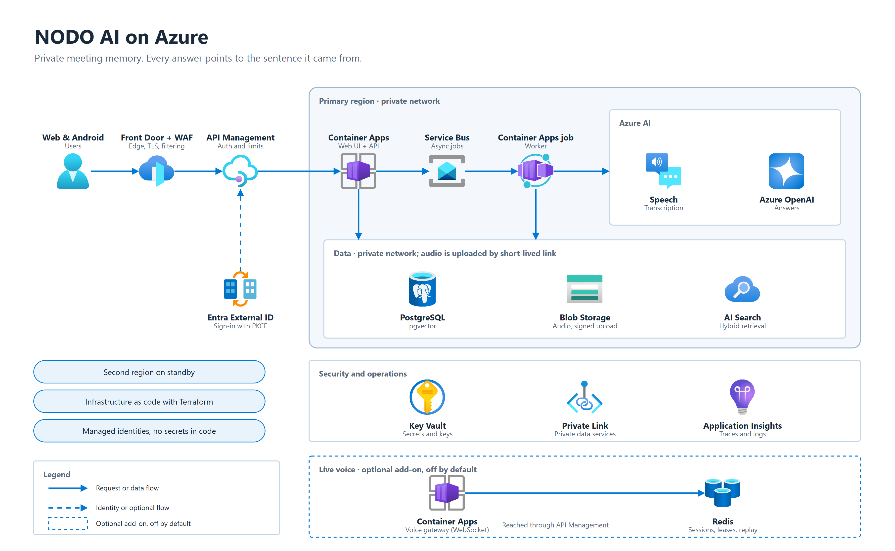
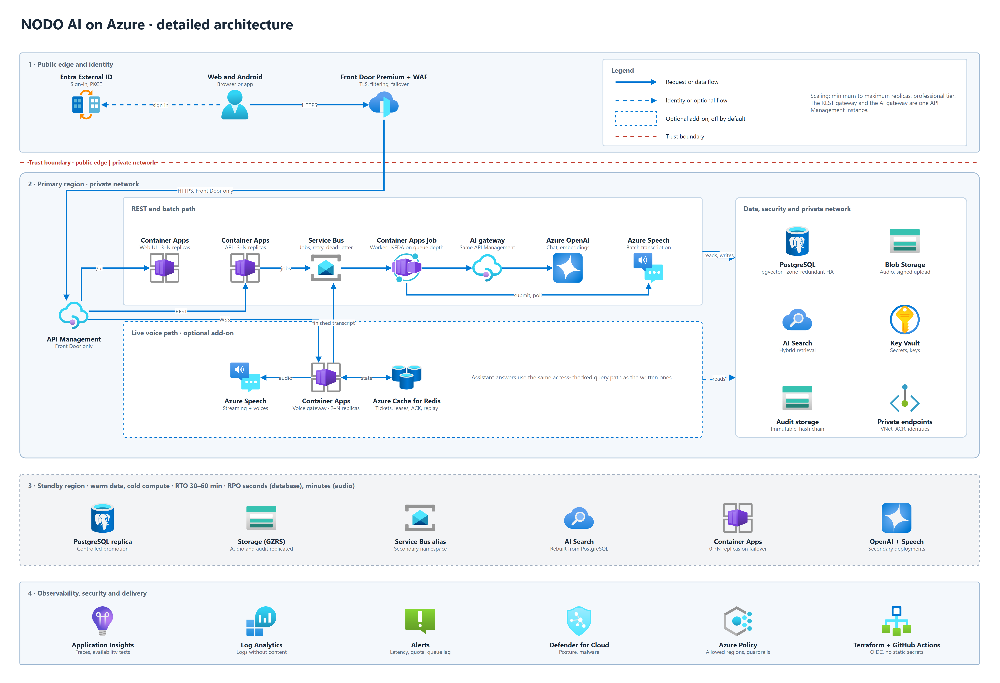
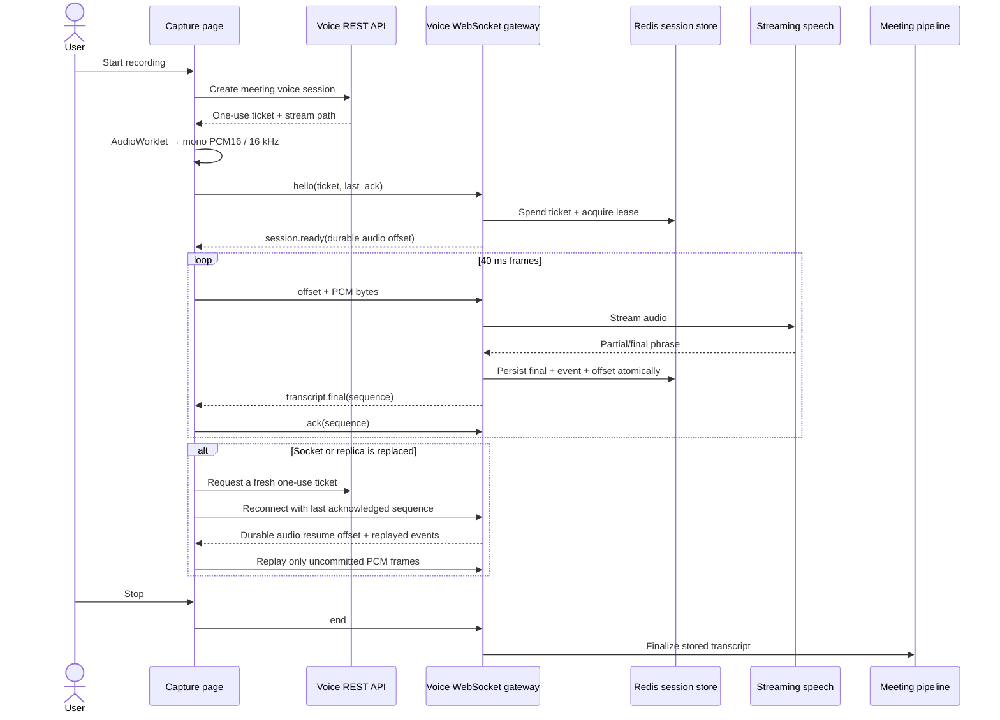

<div align="center">

# NODO AI

**A private, evidence-grounded memory for meetings.**

NODO records or imports meetings, produces speaker-aware transcripts, extracts decisions and
actions, builds a temporal knowledge graph, and answers questions with the exact sentences used as
evidence.

<p>
  
  
  
  
  
</p>

<p>
  
  
  
  
  
</p>

[Product](#product-capabilities) · [Architecture](#architecture) · [Azure](#azure-architecture) ·
[Real-time voice](#real-time-voice) · [Interface](#web-interface) · [Run locally](#quick-start) ·
[Tests](#quality-and-verification) · [Documentation](#documentation-map)

</div>

> [!IMPORTANT]
> NODO makes recording visible and requires a user attestation before capture. That attestation is
> an auditable product control; it does not replace consent or another legal basis when one is
> required.

## Product capabilities

| Capability        | What NODO does                                                                                                                                              |
| ----------------- | ----------------------------------------------------------------------------------------------------------------------------------------------------------- |
| Recording         | Captures a meeting from the browser, streams PCM audio in real time when the voice gateway is available, and falls back to encrypted upload when it is not. |
| Transcription     | Produces timestamped phrases with speaker labels. Owners may name speakers; NODO does not perform biometric speaker recognition.                            |
| Understanding     | Extracts summaries, topics, people, decisions, actions, owners, dates and evidence links.                                                                   |
| Grounded answers  | Combines lexical, vector and graph retrieval. An answer is returned only when its claims are supported by transcript citations.                             |
| Human review      | Keeps inferred relationships and decisions as proposals until a person approves or rejects them.                                                            |
| Temporal graph    | Represents meetings, people, topics, projects, decisions and actions, including replacement and contradiction relationships.                                |
| Data ownership    | Supports export, retention policies, complete meeting deletion and rebuildable search/graph projections.                                                    |
| Deployment choice | Runs as a private Windows/local engine or as a multi-service Azure deployment behind Entra authentication.                                                  |

<p align="center">
  
  
</p>

## Architecture

NODO is a **modular monolith with hexagonal ports and adapters**. Domain and application services
do not depend on Azure, SQLite, a particular model provider or the user interface. The same API
contract is backed by local adapters or Azure adapters.



### Architectural boundaries

| Layer          | Responsibilities                                                                       | Main location                                                      |
| -------------- | -------------------------------------------------------------------------------------- | ------------------------------------------------------------------ |
| Interface      | HTTP/WebSocket contracts, authentication dependencies, validation and response mapping | `services/api/src/nodo_api/api`, `services/api/src/nodo_api/voice` |
| Application    | Meeting lifecycle, ingestion, query, graph, sync, export and evidence validation       | `services/api/src/nodo_api/services`                               |
| Domain         | States, invariants, transitions, attestations and evidence-bearing models              | `services/api/src/nodo_api/domain`                                 |
| Ports          | Repository and provider contracts consumed by application services                     | `services/api/src/nodo_api/ports.py`                               |
| Adapters       | Memory, local SQLite/models, PostgreSQL, Blob, Service Bus, Search, Speech and OpenAI  | `services/api/src/nodo_api/adapters`                               |
| Clients        | Responsive web UI and Android-oriented mobile client                                   | `apps/web`, `apps/mobile`                                          |
| Infrastructure | Azure resources, policies, monitoring and plan tests                                   | `infra/terraform`                                                  |

### Completed-recording pipeline



The transcript archive is authoritative. Search and graph data are derived projections and can be
rebuilt. Jobs are idempotent, failed work moves to a dead-letter path, and a sweeper recovers work
that was accepted but not published successfully.

### Grounded query path

1. Authenticate the caller and resolve their workspace.
2. Apply ownership/ACL filters before retrieval.
3. Retrieve candidates from lexical search, vectors and the bounded graph neighborhood.
4. Optionally rerank candidates.
5. Ask the model to answer only from the supplied evidence.
6. Validate citations and answerability in application code.
7. Return the answer with transcript quotes, timestamps and meeting references, or return
   `UNANSWERABLE`.

## Azure architecture

The overview shows the platform in one picture: the edge, the application and its messaging, the
Azure AI services, the data tier (private network; audio is uploaded through short-lived signed
links) and the optional live-voice add-on (off by default).



The detailed view adds every flow, the standby region, and the observability and delivery
controls.



Both diagrams are draw.io files drawn with the official Azure icons. Edit the `.drawio`, check it
with `python tools/diagrams/check_drawio.py`, export the PNG (`node tools/diagrams/render_drawio.mjs`),
and follow the rules in [docs/DIAGRAMS.md](docs/DIAGRAMS.md).

- [overview, draw.io source](docs/images/azure-architecture-overview.drawio)
- [detailed view, draw.io source](docs/images/azure-architecture-detailed.drawio)
- [complete Azure architecture document](docs/AZURE-ARCHITECTURE.md)

### Azure component map

| Concern               | Azure implementation                                                                                |
| --------------------- | --------------------------------------------------------------------------------------------------- |
| Public edge           | Azure Front Door Premium, WAF policy, TLS and health-based routing                                  |
| Authentication        | Microsoft Entra External ID/OIDC; browser authorization-code flow with PKCE                         |
| API gateway           | API Management for REST policies and the WebSocket voice entrance                                   |
| Web application       | Static Next.js export served by an nginx Container App                                              |
| API                   | FastAPI Container App with managed identity and bounded concurrency                                 |
| Background processing | Container Apps job consuming Service Bus messages                                                   |
| Real-time media       | Dedicated voice Container App with long-lived WebSocket sessions and graceful drain                 |
| Session coordination  | TLS-only Redis for tickets, leases, admission, durable events, transcript finals and replay offsets |
| Transactional data    | Azure Database for PostgreSQL with workspace isolation and pgvector                                 |
| Audio and exports     | Blob Storage with direct scoped upload/download URLs                                                |
| Retrieval             | Azure AI Search plus PostgreSQL/pgvector; the graph remains in PostgreSQL initially                 |
| Models                | Azure OpenAI for generation/embeddings and Azure Speech for transcription/synthesis                 |
| Secrets               | Key Vault references and managed identities; no application secret is embedded in an image          |
| Messaging             | Service Bus with duplicate detection, retries and dead-letter handling                              |
| Observability         | OpenTelemetry, Application Insights, Log Analytics, alerts and availability checks                  |
| Delivery              | GitHub Actions with OIDC federation, immutable images and Terraform plans                           |

### Basic and professional tiers

|          | Basic                                                        | Professional                                          |
| -------- | ------------------------------------------------------------ | ----------------------------------------------------- |
| Regions  | One                                                          | Primary plus disaster-recovery stamp                  |
| Network  | Public endpoints protected by identity and service firewalls | Private endpoints, private DNS and restricted subnets |
| Edge     | Direct Container Apps where appropriate                      | Front Door Premium + WAF + API Management             |
| Database | Single regional PostgreSQL deployment                        | Geo-recovery design and rehearsed failover procedures |
| Voice    | Optional dedicated gateway                                   | Minimum two gateway replicas per active stamp         |

Terraform is under `infra/terraform`. Voice resources are feature-gated by `voice_enabled`, so the
existing deployment does not gain Redis or the voice application unintentionally.

> [!WARNING]
> The Azure architecture, images, policies and Terraform tests exist in the repository, but the
> complete system has not yet been certified against a live Azure subscription. Items requiring a
> real subscription are tracked in [Azure architecture, section 14](docs/AZURE-ARCHITECTURE.md#14-verification-honestly).

## Real-time voice

Real-time voice is implemented across the browser, gateway, shared session store and transcript
pipeline. It is not a separate third-party frontend service.



### Browser media path

- `AudioWorklet` captures mono floating-point samples without blocking React rendering.
- `StreamingPcm16Framer` resamples the browser rate to 16 kHz and emits 40 ms signed PCM16 frames.
- Each binary WebSocket frame starts with a big-endian millisecond offset followed by little-endian
  PCM16 samples.
- Echo cancellation, noise suppression and automatic gain control are requested from the browser.
- The UI shows elapsed time, microphone level and the latest final transcript lines.
- Audio is kept only in a bounded in-memory reconnect buffer; tickets and PCM are never written to
  local storage or logs.

### Session reliability

- Tickets are short-lived, scoped to one user/workspace/session and spent on first WebSocket use.
- Tickets travel in the first WebSocket message, never in the URL.
- Reliable server events carry a sequence number and are acknowledged by the browser.
- Transcript events and audio progress are stored atomically before the client is told to discard
  audio.
- A new gateway replica can replay unacknowledged events and resume from the durable audio offset.
- Redis failure is fail-closed: the gateway suspends the session rather than falsely acknowledging
  non-durable audio.
- Failed meeting handovers remain discoverable and are retried by a lease-protected recovery loop.
- Redis readiness is checked at application startup and by `/readyz`.

### Graceful fallback

The Capture page first attempts the real-time path. If the voice endpoint is disabled or cannot be
opened, the page deletes the provisional meeting and switches to the existing `MediaRecorder`
flow. The fallback records WebM/Opus, supports pause/resume, uploads on Stop, and uses the normal
batch pipeline. A deployment can therefore enable voice incrementally without breaking recording.

The backend protocol also supports push-to-talk assistant sessions, streaming TTS and barge-in.
The current web Capture page uses meeting mode; assistant mode is available at the protocol and
gateway layers.

Implementation details: [real-time architecture](docs/VOICE-REALTIME-ARCHITECTURE.md) and
[ADR-028](docs/adr/028-voice-gateway.md).

## Local architecture

The local engine exposes the same `/v1` API but binds to loopback and replaces Azure adapters:

| Cloud dependency      | Local implementation                                                               |
| --------------------- | ---------------------------------------------------------------------------------- |
| PostgreSQL / pgvector | SQLite with vector and full-text support                                           |
| Blob Storage          | Files under the NODO local data directory                                          |
| Service Bus           | Durable local job queue                                                            |
| Azure Speech          | Whisper-based transcription and local speaker separation                           |
| Azure OpenAI          | llama.cpp-hosted Qwen model                                                        |
| Azure AI Search       | SQLite lexical/vector retrieval with optional local reranking                      |
| Entra                 | Per-launch secret passed in the URL fragment and retained only for the browser tab |

The local service rejects non-loopback hosts and protects against DNS rebinding. Model installation,
hardware guidance and data locations are documented in [docs/DESKTOP.md](docs/DESKTOP.md).

## Web interface

The web client is a responsive Next.js static export. The same build is served by the local engine
and by the Azure web container. Runtime configuration decides which API and authentication mode to
use.

### Navigation and pages

| Page             | Purpose and behavior                                                                                                                                                                      |
| ---------------- | ----------------------------------------------------------------------------------------------------------------------------------------------------------------------------------------- |
| Home             | Entry point, product status, recent meetings, recent changes and shortcuts to Capture and Ask.                                                                                            |
| Capture          | Displays the recording notice, attestation and retention choice; runs real-time PCM/WebSocket capture or the upload fallback; shows live levels, timer, transcript and processing stages. |
| Meetings         | Lists meetings and filters by title, participant or topic with case/accent normalization.                                                                                                 |
| Meeting detail   | Shows summary, decisions, actions, participants, speaker naming controls and timestamped transcript segments. Citation links scroll to the supporting segment.                            |
| Ask              | Accepts a question and displays answerability, degraded state, citations and links back to exact transcript evidence.                                                                     |
| Graph            | Provides an accessible list as the primary representation and an interactive visual map as a secondary representation.                                                                    |
| Review           | Presents proposed graph relationships and decisions with evidence, confidence and approve/reject actions.                                                                                 |
| Settings         | Controls language, theme, export and Azure sync; reports local engine capabilities and supports index verification/repair.                                                                |
| Sign-in callback | Completes OIDC authorization-code + PKCE without exposing tokens in page content or logs.                                                                                                 |

<table>
  <tr>
    <td width="50%"><br><b>Capture.</b> Recording begins only after the attestation is checked.</td>
    <td width="50%"><br><b>Recording.</b> Timer, live level and explicit stop controls.</td>
  </tr>
  <tr>
    <td><br><b>Meetings.</b> Search and processing state at a glance.</td>
    <td><br><b>Meeting detail.</b> Evidence-bearing output and editable speaker names.</td>
  </tr>
  <tr>
    <td><br><b>Graph.</b> Explore meetings, people, topics, decisions and actions.</td>
    <td><br><b>Review.</b> Human approval remains explicit.</td>
  </tr>
</table>

### Interface engineering

- React 19 and Next.js static export; no server-rendering dependency at runtime.
- TanStack Query for bounded caching, polling and mutation invalidation.
- Zod validation at API response boundaries.
- i18next translations for English, Polish, Italian and Danish.
- Keyboard-accessible controls, visible focus, semantic labels, reduced-motion support and axe tests.
- Responsive layouts from phone width to desktop, with light and dark themes.
- Content Security Policy generated for the exported pages.
- Access tokens stay in memory/session-scoped storage according to the runtime mode; voice tickets
  stay only in the voice client instance.

## Security and privacy model

- **Authentication before data access:** local launch secret or Entra/OIDC with PKCE.
- **Authorization before retrieval:** workspace and ownership filters are applied before search or
  graph traversal.
- **No evidence, no answer:** citations and answerability are validated outside the model.
- **Minimal secrets:** Key Vault references and managed identities in Azure; no static cloud keys in
  client code.
- **Tenant isolation:** PostgreSQL roles/RLS tests, scoped object paths and workspace-aware queries.
- **Bounded input and work:** request body limits, queue limits, bulkheads, timeouts and voice
  admission limits.
- **Complete deletion:** audio, transcripts, derived search data, graph entries, cached answers and
  pending voice transcript data are removed.
- **Auditable review:** attestations and approval/rejection events are retained as explicit records.
- **Safe observability:** correlation identifiers and operational metadata are logged; audio, access
  tokens, tickets and transcript bodies are not.

See [COMPLIANCE.md](docs/COMPLIANCE.md), [SECURITY-BACKLOG.md](docs/SECURITY-BACKLOG.md) and the
security ADRs for the control-level detail.

## Repository layout

```text
apps/
  web/                         Next.js/React application, voice client, unit and browser tests
  mobile/                      Expo/React Native mobile client
services/api/
  src/nodo_api/api/            REST interface and schemas
  src/nodo_api/domain/         Domain models, rules and invariants
  src/nodo_api/services/       Application services
  src/nodo_api/adapters/       Memory, local and Azure adapters
  src/nodo_api/voice/          Real-time gateway, session store and speech integration
  tests/                       Unit, contract and integration tests
packages/contracts/            Shared OpenAPI contract
infra/
  terraform/                   Azure module, policies, monitoring and plan tests
  compose/                     Local PostgreSQL, pgvector, Neo4j and MinIO development stack
eval/                          Grounding, provenance, multilingual and access-control evaluations
tools/                         Setup, diagrams, smoke tests, benchmarks and container verification
docs/                          Architecture, operations, compliance, performance and ADRs
```

## Quick start

### Requirements

- Windows 11 for the packaged local desktop flow
- Python 3.13
- Node.js 22+
- `ffmpeg` on `PATH`
- Docker Desktop for optional integration dependencies
- NVIDIA GPU with approximately 6 GB VRAM recommended for comfortable local-model performance

### Local desktop engine

```powershell
# API and local model dependencies
cd services/api
python -m venv .venv
.venv\Scripts\python -m pip install -e ".[dev,azure,local-models]"

# Download and prepare local models (interactive; several GB)
.venv\Scripts\python ..\..\tools\local-setup\install_models.py
.venv\Scripts\python ..\..\tools\local-setup\export_embedding_onnx.py

# Build the static interface
cd ..\..\apps\web
npm ci
npm run export:desktop

# Start NODO from the repository root
cd ..\..
.\NODO.cmd
```

### Web development with the deterministic test engine

```powershell
# Terminal 1
cd services/api
$env:PYTHONPATH = "src"
python scripts/e2e_engine.py --port 8765

# Terminal 2
cd apps/web
npm ci
npm run dev
```

Open:

```text
http://localhost:3000/#token=e2e-local-engine-key-0123456789-0123456789
```

The fragment is read by the local client, moved into tab-scoped storage and removed from the visible
address. It is not sent as part of the HTTP request.

### API development

```powershell
cd services/api
python -m venv .venv
.venv\Scripts\python -m pip install -e ".[dev,azure]"
.venv\Scripts\python -m pytest
```

Optional local infrastructure:

```powershell
docker compose -f infra/compose/docker-compose.yml --env-file infra/compose/.env.example up -d
```

### Enable the voice gateway locally

The gateway is deliberately disabled by default. At minimum it requires a 32-byte ticket key and a
recognizer configuration:

```powershell
$env:NODO_VOICE_ENABLED = "true"
$env:NODO_VOICE_TICKET_KEY = "replace-with-at-least-32-random-characters"
$env:NODO_VOICE_RECOGNIZER = "local"
```

Azure deployments additionally require a TLS Redis URL and Azure Speech configuration. See
[ADR-028](docs/adr/028-voice-gateway.md) for the full environment contract.

## Quality and verification

### Web application

```powershell
cd apps/web
npm run typecheck
npm run lint
npm run format:check
npm test -- --coverage
npm run build
npm run test:e2e
```

The web suite covers API boundaries, OIDC/PKCE, repositories, recorder state, PCM conversion,
AudioWorklet integration, WebSocket handshake, ACK, bounded replay, ticket refresh, reconnect,
fallback upload, accessibility and the main user journeys. The real-browser voice test uses a fake
microphone, forces a `1012` rolling-restart disconnect, verifies a fresh ticket and confirms the
session reconnects.

### API and voice gateway

```powershell
cd services/api
python -m pytest
python -m ruff check src tests

# Optional real Redis contract tests
$env:NODO_TEST_REDIS_URL = "redis://127.0.0.1:6390/15"
python -m pytest tests/test_voice_store.py tests/test_voice_session.py
```

### Terraform

```powershell
terraform -chdir=infra/terraform/modules/nodo fmt -check
terraform -chdir=infra/terraform/modules/nodo validate
terraform -chdir=infra/terraform/modules/nodo test
```

### Evaluation and benchmarks

- Grounding, access and multilingual evaluation: [eval/README.md](eval/README.md)
- Performance targets and measurements: [docs/PERFORMANCE.md](docs/PERFORMANCE.md)
- Local scorecard: [docs/LOCAL-PERFORMANCE-SCORECARD.md](docs/LOCAL-PERFORMANCE-SCORECARD.md)
- Benchmark plan, soak tests and release gates: [docs/BENCHMARK-PLAN.md](docs/BENCHMARK-PLAN.md)
- Voice session metrics: `tools/voice-bench`

## Deploying to Azure

Terraform supports a smaller basic topology and a private, multi-region professional topology.
Follow [FIRST-DEPLOY.md](docs/FIRST-DEPLOY.md); do not treat a successful plan as production
certification.

The deployment sequence is:

1. Configure the Azure subscription and GitHub OIDC federation.
2. Provision Terraform state and the selected infrastructure tier.
3. Build, scan and publish immutable API/web images.
4. Run database migration using its dedicated identity.
5. Deploy application revisions and run public smoke checks.
6. Validate Entra login, uploads, queue processing, search, deletion and export.
7. If voice is enabled, validate APIM WebSocket upgrade, Redis TLS/private connectivity, rolling
   drain, reconnect and Azure Speech latency.
8. Rehearse rollback, queue recovery, database recovery and regional failover before real users.

Operational procedures are in [RUNBOOKS.md](docs/RUNBOOKS.md).

## Design principles

1. **Evidence or silence.** An unsupported answer is refused.
2. **Authorization before retrieval.** The model never receives evidence the caller may not access.
3. **Visible recording.** Capture requires a deliberate action and remains visibly active.
4. **Humans decide.** Inferences remain proposals until reviewed.
5. **Archive first.** Search and graph are replaceable projections of authoritative records.
6. **Fail closed on durability.** NODO does not acknowledge audio or work that has not been stored.
7. **Bound everything.** Inputs, concurrency, retries, graph traversal, buffers and session duration
   have explicit limits.
8. **One contract, two engines.** Local and Azure implementations preserve the same product behavior.
9. **Accessible by default.** The text/list representation is primary; visualizations are additive.
10. **Be honest about operational proof.** Mocked plans and local tests are not described as a live
    production deployment.

## License

NODO AI is open source under the [Apache License 2.0](LICENSE). Copyright 2026 Pierfrancesco Lijoi.

## Documentation map

| Topic                                                | Document                                                                   |
| ---------------------------------------------------- | -------------------------------------------------------------------------- |
| Solution architecture and quality attributes         | [docs/ARCHITECTURE.md](docs/ARCHITECTURE.md)                               |
| C4 system, container, deployment and voice views     | [docs/architecture](docs/architecture)                                     |
| Azure topology and verification status               | [docs/AZURE-ARCHITECTURE.md](docs/AZURE-ARCHITECTURE.md)                   |
| How to draw the architecture diagrams in draw.io     | [docs/DIAGRAMS.md](docs/DIAGRAMS.md)                                       |
| Verifying the Terraform before it meets a real account | [docs/IAC-CONFIDENCE.md](docs/IAC-CONFIDENCE.md)                         |
| Real-time voice design and measured gateway behavior | [docs/VOICE-REALTIME-ARCHITECTURE.md](docs/VOICE-REALTIME-ARCHITECTURE.md) |
| API contract                                         | [docs/API-V1.md](docs/API-V1.md)                                           |
| Desktop installation and local data                  | [docs/DESKTOP.md](docs/DESKTOP.md)                                         |
| First Azure deployment                               | [docs/FIRST-DEPLOY.md](docs/FIRST-DEPLOY.md)                               |
| Operations and incident response                     | [docs/RUNBOOKS.md](docs/RUNBOOKS.md)                                       |
| Security, GDPR and AI transparency controls          | [docs/COMPLIANCE.md](docs/COMPLIANCE.md)                                   |
| Capacity assumptions                                 | [docs/CAPACITY-MODEL.md](docs/CAPACITY-MODEL.md)                           |
| Design system and accessibility                      | [docs/DESIGN.md](docs/DESIGN.md)                                           |
| Architectural decisions                              | [docs/adr](docs/adr)                                                       |

## Current status

- Local meeting capture, ingestion, grounded query, graph, review, export and deletion are
  implemented and exercised end to end.
- The browser real-time client and backend voice gateway are implemented, including durable ACK,
  cross-replica replay, bounded reconnect buffering and fallback upload.
- Azure infrastructure, policies and application images are represented in Terraform and automated
  tests.
- A live Azure subscription certification, provider latency run, production load/soak test and
  disaster-recovery rehearsal are still required before claiming production readiness.
