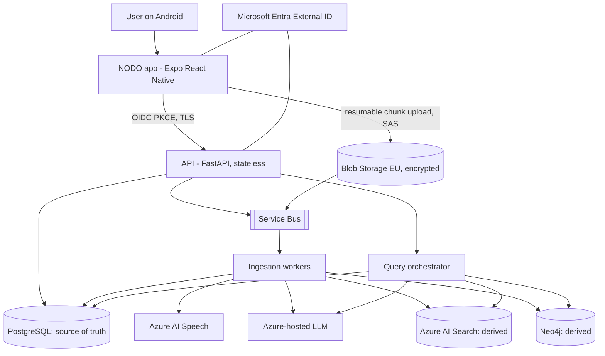
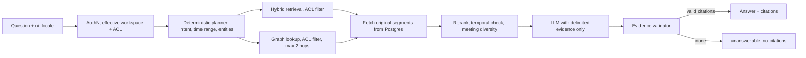

# NODO AI - Solution Architecture

Status: v0.1 draft. Source product intent: [blueprint](product/blueprint.it.md) (Italian). This document fixes the structural decisions that let the product start as one person's private beta and grow to a multi-workspace service without a rewrite. Decisions are recorded as ADRs in [adr/](adr/).

## 1. Quality attributes (ranked)

| # | Attribute | What it means here | Mechanism |
|---|---|---|---|
| 1 | Privacy and legal defensibility | No hidden recording, no cross-workspace leak, deletion that really deletes | Visible capture, per-meeting attestation, ACL before retrieval, derived stores rebuildable and erasable |
| 2 | Trust in answers | Every claim traces to a transcript segment, or the product says it cannot answer | Evidence validator in code, `unanswerable` is a first-class outcome |
| 3 | Scalability | Growth in meetings per workspace and in workspaces without redesign | Stateless API, queue-based ingestion, `workspace_id` as universal partition key |
| 4 | Evolvability | Swap Azure services, models, vector or graph stores | Hexagonal ports and adapters, contract-first API |
| 5 | Resilience on the device | A 60 minute recording survives kills and bad networks | Encrypted chunk log, resumable uploads, ACK manifest |
| 6 | Cost control | EUR per audio hour is visible and bounded | Scale-to-zero workers, per-step token and minute metering |
| 7 | Multilingual correctness | UI and content work in English, Polish, Italian, Danish | See section 8 |

## 2. Architectural style

**Modular monolith for the synchronous API, separate asynchronous workers for heavy work.** Not microservices.

- One engineer, one release train: network boundaries between modules cost more than they return today.
- Module boundaries are enforced as Python packages that talk through `ports` (typing.Protocol). Any module can later be lifted into its own service because its only dependencies are ports and events, not shared tables.
- Heavy and bursty work (speech-to-text, extraction, graph upsert, indexing) is already out of process behind a queue, which is where scale actually bites.

Split triggers (any one is enough): a module needs a different scaling profile than the API, a different data-residency or security zone, or an independent release cadence.

## 3. System context and containers

Trust boundaries: device to public API; API to private network; workers to model endpoints. Queue messages carry object references, never audio or transcript text.

## 4. Modules (bounded contexts)

| Module | Owns | Talks to | Sync or async |
|---|---|---|---|
| Identity and workspace | users, workspaces, roles, effective permissions | Entra | sync |
| Capture and sync | meeting record, upload sessions, chunk manifest, state machine | Blob, queue | sync + events |
| Compliance | attestation, retention policy, export, erase cascade, audit log | all stores via erase port | sync + jobs |
| Ingestion | STT, diarization, segmentation, quality checks | Speech, queue | async |
| Knowledge | extraction (claims, decisions, actions, entities), entity resolution, human review | LLM, Postgres | async + review UI |
| Retrieval and answers | hybrid retrieval, graph lookup, evidence validation, answer synthesis | Search, graph, Postgres, LLM | sync |
| Platform | config, telemetry, correlation ids, error envelope | everywhere | cross-cutting |

Rule: a module reads another module's data only through its port. Postgres schemas are per module so a split is a connection-string change.

## 5. Scalability design

### 5.1 Principles

1. **Stateless compute.** API and workers hold no session state; replicas are interchangeable.
2. **`workspace_id` is the partition key everywhere**: Postgres rows (row level security), blob prefixes, Search filter, graph node property, queue message attribute, log field. It is the unit of isolation, quota, sharding and deletion.
3. **At-least-once with idempotency.** Every job carries `source_hash + pipeline_version + event_id`. Handlers upsert; replays are safe. Writes that must publish an event use a transactional outbox.
4. **Source of truth vs derived stores.** Postgres plus Blob are authoritative. Azure AI Search and Neo4j are projections that can be dropped and rebuilt by replaying events (ADR-007). This makes schema migration, model upgrade and erasure routine instead of risky.
5. **Backpressure over blocking.** Queue depth and message age drive worker scaling (KEDA on Container Apps). Per-workspace concurrency caps stop a noisy tenant starving others.
6. **Bounded query work.** Graph hops capped at 2, node cap, token budget and a hard timeout per request; the planner is deterministic, not an open agent.

### 5.2 Scaling ladder

| Stage | Shape | Moves up when |
|---|---|---|
| 0. POC | Docker Compose: API, Postgres+pgvector, Neo4j, MinIO, mocked Speech and LLM | A real recording flows end to end |
| 1. Private beta (1 to 20 users) | Azure Container Apps: API min 1 replica, workers scale to zero, one Postgres Flexible Server, one Search service, one Neo4j instance | p95 query latency or queue age breaches SLO for a week |
| 2. Team / enterprise | Same topology, workspace sharding of Search indexes and graph databases, private endpoints, customer-managed keys, per-workspace quotas | One workspace exceeds a shared-instance share, or contract demands isolation |
| 3. Platform | AKS or dedicated environments per large tenant, read replicas, regional cells | SLOs or isolation needs that Container Apps cannot meet |

Nothing above stage 1 is built now. The seams that make it cheap (ports, partition key, rebuildable projections) are built from day one.

### 5.3 Capacity assumptions (to validate in the beta)

One user: about 6 meetings per week, 45 minutes each, so about 4.5 audio hours per week. At 100 users: 450 audio hours per week, about 3 concurrent transcriptions at peak if processed in near real time. These numbers drive cost per audio hour, which is the first metric to instrument.

## 6. Data architecture

| Store | Role | Authoritative | Rebuildable |
|---|---|---|---|
| PostgreSQL | meetings, segments (versioned), speakers, claims, decisions, actions, attestations, ACL, audit, outbox | yes | n/a |
| Blob Storage | encrypted audio chunks, exports | yes (audio) | no |
| Azure AI Search | BM25 plus dense vectors per segment, workspace filter | no | yes, from Postgres |
| Neo4j | entities, decisions, supersession, `SUPPORTED_BY` edges | no | yes, from Postgres |

- Transcripts are immutable per version; a correction creates version N+1.
- An unreviewed LLM extraction never becomes an official decision; it stays `proposed` until a person approves it.
- Every graph edge and index document stores `meeting_id`, `segment_id`, `extraction_version`, so audit and cascade deletion are queries, not archaeology.
- Retention is policy per data class: audio (default 30 days), transcript, graph.

## 7. Query path (trust pipeline)

Control lives in code. The model never chooses `workspace_id`, never sees unauthorised data, and its citations are accepted only if they point to segments that were retrieved and visible to the caller. LangGraph is allowed only for the planner and tool loop in this path (ADR-003).

## 8. Multilingual architecture (en, pl, it, da)

There are three independent language axes. Mixing them up is the usual source of bugs.

| Axis | Values | Rule |
|---|---|---|
| UI locale | `en`, `pl`, `it`, `da` | App chrome, legal notices, errors, answer language. Fallback `en`. Stored per user. |
| Spoken language | per meeting, one or more of the four (code-switching allowed) | Passed to Speech as a candidate-language list with language identification. Stored on the meeting. |
| Content language | per transcript segment | Drives the search analyzer and quote rendering. |

Decisions:

- **App i18n:** i18next with one JSON resource per locale, `en` is the source of truth. Polish has four plural forms and Danish and Italian differ from English: all counts use plural keys, never string concatenation. Dates and numbers via `Intl`. A CI test fails when a locale misses a key or has an extra one.
- **Legal copy is versioned per locale.** `notice_version` plus `locale` is stored in the recording attestation. Translations of legal text are reviewed by a person, not machine-only, before release.
- **Cross-lingual retrieval.** Dense retrieval uses a multilingual embedding model, so a Danish question finds an English segment. Lexical retrieval keeps exact ids and names, with a language-aware analyzer per content language (Azure provides Microsoft analyzers for these four languages; confirm names and fields at implementation).
- **Answer language follows `ui_locale`.** Quotes in citations stay verbatim in the source language; the app can offer an on-demand translation labelled as such.
- **Entities are language neutral.** Canonical name plus aliases; resolution never merges two people on a shared first name alone.
- **Evaluation covers languages.** The golden set has cross-lingual cases and the same question in all four locales; faithfulness is reported per language.

## 9. Security and privacy architecture

| Concern | Control |
|---|---|
| Visible recording | Android foreground service of type microphone, persistent notification, explicit start from a visible screen |
| Legal gate | Per-meeting attestation (user, meeting, notice version, locale, retention policy), HMAC-signed server side; documents the user's declaration, does not claim participant consent |
| Tenant isolation | Row level security, Search and graph filters, queue attributes, ACL-negative tests in CI (0 leaks allowed) |
| Secrets | No keys on the device; Key Vault plus managed identity; short-lived SAS minted by the API |
| Prompt injection | Transcript text is data, delimited and never an instruction; tools are read-only allowlists; output validated |
| Logging | Correlation ids, no transcript text or tokens in logs |
| Erasure | Tombstone then cascade through ports to blob, Search, graph; verified by a test that nothing remains retrievable |
| Data location | EU regions, deployment-specific verification of processing and abuse monitoring |

## 10. Mobile architecture

- Expo (React Native, TypeScript) with Expo Router; development build, not Expo Go, because capture needs a native foreground service module.
- Layers: `app/` routes only; `features/<name>` screens and logic; `domain/` types mirrored from the OpenAPI contract; `data/` repository interfaces with `mock` and `http` adapters; `ui/` design system; `i18n/` locales. UI never imports an adapter directly.
- Offline-first capture: encrypted chunk files, a manifest with SHA-256 and sequence numbers, an uploader that resumes from the first un-ACKed chunk.
- Accessibility: the entity and relation **list** is the primary view of the graph; the node diagram is secondary.
- Design system: tokens (color, type, space, radius), dark and light, one accent, Geist, an icon family, 44 px touch targets, reduced-motion support.

## 11. Observability, quality and delivery

- OpenTelemetry with correlation ids from device to worker; PII redacted in traces.
- AI metrics: citation precision, faithfulness, answerability rate, per-step tokens and cost, ACL leak count.
- CI on every push: lint, types, tests with coverage gate, golden-set schema validation, compose validation, secret scan. Release gate adds the retrieval evaluation run.
- Environments: local (Compose), dev, staging, prod. Terraform for Azure, GitHub Actions for deploys with approval on prod.

## 12. Azure mapping

Azure is the cloud target. The full service map, identity model, networking stages, search design for four languages and the pre-deployment checklist are in [AZURE-ARCHITECTURE.md](AZURE-ARCHITECTURE.md) (ADR-010, ADR-011, graph design in ADR-012). One change from the diagram in section 3: in the Azure beta the graph is served from PostgreSQL behind the `GraphStore` port, and Neo4j is added only if needed.

## 13. Risks and open questions

| Risk | Impact | Mitigation |
|---|---|---|
| Recording legality varies by country and workplace | Product cannot be used as intended | Legal review before beta; attestation plus optional participant notice flow |
| Diarization quality on noisy audio | Wrong attribution | Anonymous labels only; human correction; DER measured |
| Neo4j hosting and region fit | Cost, residency | Graph is a rebuildable projection; Postgres-only fallback for beta |
| LLM extraction errors | False decisions | Human review before approval; evidence required |
| Foreground service policy changes | Capture breaks on new Android | Native module isolated behind a port; device matrix tests |

Open: legal entity and controller role, hosted Neo4j choice, embedding model choice and licence, whether participant consent via invite or QR is in the first release.
