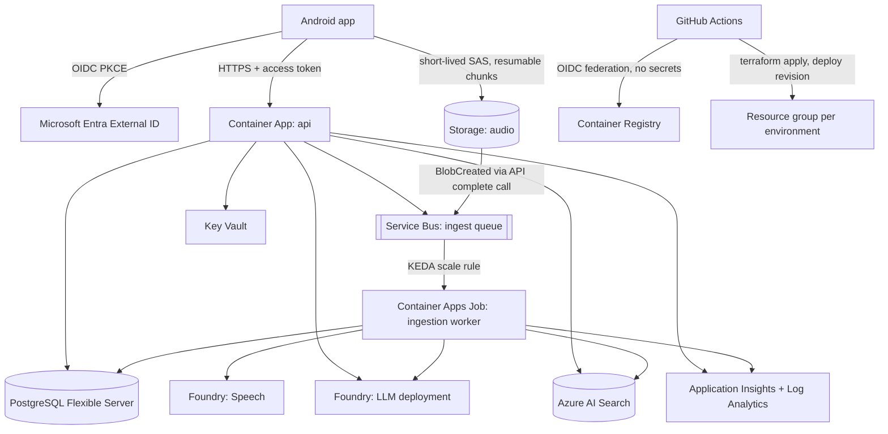

# NODO AI - Azure architecture

Status: v0.1 design, nothing deployed. Extends [ARCHITECTURE.md](ARCHITECTURE.md) section 12. Decisions: [ADR-010](adr/010-azure-target-and-iac.md), [ADR-011](adr/011-retrieval-and-graph-staging.md).

The mobile app talks to **one** public endpoint, the NODO API. Everything else is private to the API and its workers and is reached with managed identities. The app never holds an Azure key.

## 1. Topology

## 2. Services and why

| Concern | Azure service | Beta SKU (private use) | Production direction | Notes |
|---|---|---|---|---|
| API and workers | Container Apps (Consumption) | api min 1 replica, worker job scales to zero | workload profiles, zone redundancy | KEDA scales the worker on Service Bus queue length; scaling to zero costs nothing |
| Container images | Container Registry | Basic | Standard or Premium (geo, private link) | GitHub pushes with OIDC, Container Apps pulls with managed identity |
| Identity for users | Microsoft Entra External ID | free tier | custom domain, MFA policy | Separate external tenant, created by hand (not Terraform); tokens carry `sub` and a `workspace_id` claim minted by a custom claims provider |
| Identity for services | User-assigned managed identities | one for api, one for worker | one per module | No connection strings, no keys; Terraform grants least-privilege roles |
| Relational store | PostgreSQL Flexible Server | Burstable B1ms, 32 GB, PITR 7 days | General Purpose, zone-redundant HA, read replica | Source of truth; extensions `vector`, `pg_trgm`; row level security keyed on `app.workspace_id` |
| Audio and exports | Blob Storage (StorageV2, LRS) | LRS, versioning off for audio, lifecycle delete at retention | ZRS or GZRS, immutability policies for audit exports | Shared-key access disabled, Entra only; lifecycle rule enforces the audio retention default (30 days) |
| Queue | Service Bus | Standard (duplicate detection, topics later); a Basic queue would work for one queue, check the feature table before choosing | Premium when throughput or private link requires | Queue `ingest`, dead-letter on, max delivery count 5 |
| Search | Azure AI Search | Free for dev, Basic for beta | Standard with partitions per scale | One index, one analyzer field per content language (`text_en`, `text_pl`, `text_it`, `text_da`), filter on `workspace_id` and `meeting_id` |
| Speech to text | Foundry resource for Speech | pay per audio hour | same, region per data policy | Batch transcription with diarization; see section 5 |
| LLM | Foundry resource, Azure OpenAI deployment | one chat deployment, one embedding deployment | regional deployment types chosen by data policy | Provider adapter keeps the model replaceable |
| Secrets | Key Vault (RBAC mode) | Standard | Premium or managed HSM for customer-managed keys | Only for what cannot be identity-based (attestation HMAC key, third-party tokens) |
| Observability | Log Analytics + Application Insights | workspace-based, 30 day retention | longer retention, alerts, workbooks | OpenTelemetry with transcript text and tokens redacted |

Neo4j is **not** in the Azure beta: the graph is a rebuildable projection (ADR-007) served from Postgres tables behind the `GraphStore` port (ADR-011).

## 3. Identity and access

1. The app signs the user in with Authorization Code + PKCE against Entra External ID and receives an access token for the NODO API (`aud` = API app id, `iss` = the external tenant).
2. The API validates the token (RS256, JWKS cached, issuer and audience pinned, `workspace_id` claim format checked, token lifetime capped). The code is already written and tested; only the JWKS fetch and cache remain (SECURITY-BACKLOG).
3. The API calls Azure services as its managed identity. No user token is forwarded.
4. Audio upload: the API mints a user-delegation SAS limited to one blob path, write-only, 15 minutes. The app uploads chunks directly to Blob, then calls `complete`.

Role assignments (Terraform):

| Principal | Scope | Role |
|---|---|---|
| api identity | storage account | Storage Blob Data Contributor (to mint user-delegation SAS and read exports) |
| api identity | Service Bus | Azure Service Bus Data Sender |
| api identity | Foundry resources | Cognitive Services User (OpenAI inference) |
| api identity | AI Search | Search Index Data Reader |
| worker identity | storage | Storage Blob Data Reader (audio), Contributor (transcripts) |
| worker identity | Service Bus | Azure Service Bus Data Receiver |
| worker identity | Foundry resources | Cognitive Services User, Cognitive Services Speech User |
| worker identity | AI Search | Search Index Data Contributor |
| both | Key Vault | Key Vault Secrets User |
| both | ACR | AcrPull |
| GitHub deploy identity | resource group | Contributor (plan) and a narrower role for revisions; federated credential per environment |

PostgreSQL uses Entra authentication for the two identities (no password in config); the admin password lives only in Key Vault for break-glass.

## 4. Networking by stage

| Stage | Network | Why |
|---|---|---|
| Beta | Public endpoints, every data service with Entra-only auth, shared keys off, firewall allowing Azure services and the Container Apps environment egress | Private endpoints add cost and setup that a one-person beta does not need |
| Team and enterprise | Container Apps environment in a VNet, private endpoints for Postgres, Storage, Key Vault, Search, Service Bus, Foundry; public access disabled; WAF in front of the API | The ARCHITECTURE.md trust boundaries are enforced by the network too |

Terraform keeps this behind one variable, `private_networking`, so the move is a plan, not a rewrite.

## 5. Speech: decision needed after a spike

Documented facts (Microsoft Learn, checked 22 October 2026):

- Batch transcription supports diarization on mono audio (`diarizationEnabled`, and `diarization` min and max speakers for three or more, up to 35), with a 240 minute limit per file, and language identification with 2 to 10 candidate locales.
- Language identification is not available together with a custom model in batch.
- Fast transcription lists `pl-PL`, `da-DK`, `it-IT`, `en-US` and `en-GB`.
- MAI-Transcribe and LLM Speech are newer options that list Polish, Danish and Italian with diarization and language identification, called through the fast transcription endpoint.
- The per-locale diarization quality for Polish and Danish is not documented.

So the ingestion worker has a `SpeechToText` port with two adapters to try on real recordings in each language: batch with diarization, and the newer fast path. The golden set gets a speech slice (word error rate and speaker confusion per language) before one is chosen. Speaker labels stay anonymous either way.

## 6. Ingestion and query flows

Ingestion: app uploads chunks to Blob, calls `POST /v1/meetings/{id}/complete`, the API verifies the chunk manifest and publishes one message `{meeting_id, workspace_id, source_hash, pipeline_version, event_id}` (no audio, no text). The worker job starts when the queue is non-empty, transcribes, diarizes, extracts claims with the LLM, writes versioned segments to Postgres, indexes segments in Search, rebuilds graph rows, and moves the meeting to `review`. Retries use the dead-letter queue after 5 deliveries; every step is idempotent on `source_hash + pipeline_version + event_id`.

Query: the API authenticates, loads the caller's allowed meeting ids from Postgres, runs hybrid search with a filter on workspace and those ids, reads the graph slice from Postgres, calls the LLM with delimited evidence, validates citations against Postgres, and returns the answer in the user's UI language.

## 7. Search index design (4 languages)

One analyzer per field, so each segment is indexed into the field of its own language:

| Field | Analyzer |
|---|---|
| `text_en` | `en.microsoft` |
| `text_pl` | `pl.microsoft` |
| `text_it` | `it.microsoft` |
| `text_da` | `da.microsoft` |
| `vector` | multilingual embedding deployment, same dimension for all |
| `workspace_id`, `meeting_id`, `segment_id`, `started_at_ms`, `version` | filterable, retrievable |

Queries run against all four text fields plus the vector; a Danish question finds an English segment through the vector side. Analyzer names are from the Microsoft Learn list of supported analyzers.

## 8. Environments and delivery

- One subscription (or at minimum one resource group) per environment: `dev`, `staging`, `prod`. Terraform state in a Storage account with versioning and Entra-only access, one state file per environment.
- GitHub Actions authenticate with OIDC federated credentials, no client secrets. Pull requests run `terraform plan` and comment the result; `main` applies to dev; staging and prod need an approval.
- Images are built once, signed, scanned, and promoted by digest. Container Apps revisions give canary traffic splitting and instant rollback.
- Database migrations run as a job before the new revision receives traffic.

## 9. Cost control (to be measured, not promised)

Fixed monthly drivers in a beta: Search Basic, Service Bus Standard, Postgres B1ms, the api at one replica, Log Analytics ingestion. Variable: Speech audio hours and LLM tokens. Controls: a subscription budget with alerts at 50, 80 and 100 percent, scale-to-zero worker, Free Search tier in dev, log sampling, per-meeting cost recorded in telemetry so EUR per audio hour is a dashboard number. Prices change; read them from the Azure pricing calculator when sizing.

## 10. Backup, recovery and deletion

- Postgres point-in-time restore (7 days beta, longer in prod); restore drill before any real user.
- Blob soft delete for accidental loss only on exports; audio follows the retention policy and is not recoverable after its lifecycle delete.
- Erasure cascade stays ADR-007: tombstone in Postgres, then Search documents, graph rows, blobs; a reconciliation job finds tombstoned meetings that still have derived data.
- Region loss: infrastructure is code, data restore from backups; no active-active in beta.

## 11. Things to verify before the first apply

1. Region: pick one EU region where Container Apps, Foundry Speech, an OpenAI chat and embedding model, AI Search and Postgres Flexible Server are all available. Default in code is `swedencentral`; confirm with `az` and the model availability pages.
2. Foundry data-processing terms and whether abuse monitoring applies to the chosen deployment type, for the legal review in ADR-005.
3. Entra External ID tenant creation and the custom claims provider that adds `workspace_id`.
4. Quotas: Container Apps cores, OpenAI tokens-per-minute, Speech concurrent batch jobs.
5. Name uniqueness: Storage, Key Vault, ACR, Search and Postgres names are global or regional.
