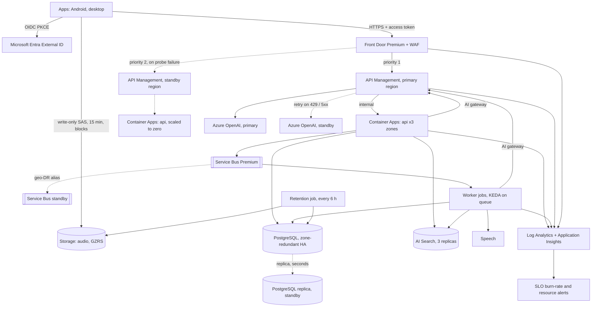

# NODO AI - Azure architecture

Status: v2 design, 23 October 2026. Nothing is deployed; the Azure side has never run against a subscription. Extends [ARCHITECTURE.md](ARCHITECTURE.md) section 12. Decisions: [ADR-010](adr/010-azure-target-and-iac.md), [ADR-011](adr/011-retrieval-and-graph-staging.md), [ADR-016](adr/016-edge-and-api-gateway.md) (edge and gateway), [ADR-017](adr/017-resilience-and-disaster-recovery.md) (resilience), [ADR-018](adr/018-observability-and-slos.md) (observability), [ADR-019](adr/019-compliance-and-data-governance.md) (compliance). Sizing: [CAPACITY-MODEL.md](CAPACITY-MODEL.md). Operations: [RUNBOOKS.md](RUNBOOKS.md). Controls: [COMPLIANCE.md](COMPLIANCE.md).

The module has two tiers, chosen by `tier`:

| | `basic` | `professional` |
|---|---|---|
| For | a personal or demo deployment | a service people depend on |
| Region | one | two (primary plus standby) |
| Network | public endpoints, Entra-only auth | virtual network, private endpoints, no public data endpoint except audio uploads |
| Entrance | the Container App | Front Door Premium + WAF, then API Management |
| Models | direct | through the AI gateway, two regions |
| Availability | single replica, no zones | three zones, HA database, three replicas minimum |
| Recovery | restore from backup | replica, geo-redundant storage, scaled-to-zero standby |
| Operations | logs, budget | SLO alerts, availability test, diagnostics everywhere, workbook, policy, Defender, locks |

Everything below describes the **professional** tier unless it says otherwise.

## 1. Principles

1. **One way in.** Users and the models are reached through gateways; no service has a second public door.
2. **Identity, not secrets.** Managed identities and Entra tokens everywhere; the only secrets are the attestation key, the telemetry salt and the break-glass database password, in Key Vault.
3. **Fail small.** Every dependency has a limit, a timeout and a breaker; a failing model degrades answers, it does not fail requests (ADR-017).
4. **Derived data is rebuildable.** The search index and graph projections come from PostgreSQL; only PostgreSQL and audio are irreplaceable (ADR-007).
5. **Capacity from the workload.** Sizes are read off a model of what the application does, not chosen by habit (CAPACITY-MODEL.md).
6. **Symptoms before causes.** Alerts follow what people feel (ADR-018).
7. **Compliance as configuration.** Residency, retention, immutability, locks and encryption are code with a test, not a document.
8. **Same code on both tiers.** The application reads its environment; the tier changes what it is connected to, not how it behaves.

## 2. Topology

Request path: Front Door -> API Management -> Container Apps. Async path: API -> Service Bus -> worker -> PostgreSQL, Search, models, Speech. Model path: caller -> AI gateway -> account in the nearest healthy region. Data path for audio: client -> blob directly, by short-lived SAS.

## 3. The entrance (ADR-016)

| Layer | Enforces | Does not do |
|---|---|---|
| Front Door Premium | TLS, WAF (default rule set 2.1, bot manager 1.1), per-address rate limit, region failover on probe failure | caching, authentication |
| API Management | only-Front-Door (network tag and `X-Azure-FDID`), token validation, per-user rate limit, backend per region, circuit breaker, request id and `traceparent`, header hygiene | retries of the public API, business rules |
| API (in the container) | token verification again (JWKS cache with rotation), `azp` pinning, workspace tenancy, body limits, load shedding, idempotency | transport security |

Each layer assumes the one in front of it may have been misconfigured; none is the only protection for anything.

## 4. Compute

- **Container Apps environment** per region, workload-profile mode, zone redundant, internal load balancer, in the `snet-aca` subnet. Ingress restricted to the gateway subnet.
- **API**: three replicas minimum (one per zone) and a concurrent-request scale rule. `WEB_CONCURRENCY` follows vCPU (one process each). Startup, liveness (`/healthz`) and readiness (`/readyz`, database only) probes; 30 s termination grace with a 25 s graceful shutdown in `serve.py`, so a rolled replica finishes its requests.
- **Worker**: a job triggered by KEDA on the queue length with the worker identity, 15 s polling, one message per execution, 1 hour timeout, one retry.
- **Migrate** (manual, before a rollout) and **retention** (cron every six hours) jobs, each with its own identity and database role.
- **Revisions**: single revision mode with readiness gates; rollback is activating the previous revision. The deploy pipeline owns the image; Terraform ignores it.

## 5. Data

| Store | Configuration | Why |
|---|---|---|
| PostgreSQL 16 Flexible Server | General Purpose, zone-redundant HA, 35 day point-in-time restore, geo-redundant backup, cross-region replica, delegated subnet (no public endpoint), `track_io_timing`, slow statements logged at 1 s, weekly maintenance window | irreplaceable source of truth; row level security; Entra-only roles |
| Blob: audio account | GZRS, customer-managed key (RSA-HSM, auto-rotated), infrastructure encryption, **no** versioning or change feed (a version would keep an erased recording alive), 7 day soft delete as the only copy after an erasure, SAS lifetime capped, no shared key, malware scan | the only public data endpoint, with compensating controls (ADR-016) |
| Blob: audit account | GZRS, private, time-based retention (WORM) | evidence that cannot be altered; archive job not yet built |
| Service Bus Premium | one messaging unit, private, geo-DR alias to the standby namespace, duplicate detection 1 h, 5 deliveries then dead-letter | shock absorber between the app and slow work |
| AI Search Standard | three replicas, partitions from the capacity model, private, RBAC only | derived: rebuilt from PostgreSQL in the standby region |
| Key Vault Premium | purge protection, 90 day soft delete, firewall, RBAC | secrets and the storage key |

The database role design is part of the architecture: the api and worker identities each get a login role named after the identity, with data rights but no DDL, under forced row level security, and with the audit table append-only for them. The retention identity gets only the `nodo_retention` role (it can see which meetings are due, across workspaces) and the right to append audit events; it never reads transcripts or the graph. The migrate identity is the Entra administrator and owns the schema.

## 6. AI services

- **Models.** Azure OpenAI accounts in both regions with the same deployments (EU data-zone deployment type), reached only through the AI gateway. Each caller identity has its own token-per-minute budget; a 429 or a server error retries once or twice in the other region. The long-lead item is the token quota (CAPACITY-MODEL.md section 4).
- **Speech.** Batch transcription with diarization and language identification; see section 12 for the open decision and the staged-pipeline gap. Results are read by the worker, never by the client.
- **Embeddings.** 512 dimensions, int8; the choice stands only if retrieval quality on the golden set holds.

## 7. Identity and access

Identities (user-assigned, one per job of work): `api`, `worker`, `migrate`, `retention`, `storage` (used only so the audio account can read its key). Users sign in with PKCE against Entra External ID; the API accepts only the configured client application ids (`NODO_OIDC_ALLOWED_CLIENT_IDS`, the `azp` claim).

| Principal | Scope | Role |
|---|---|---|
| api, worker, migrate, retention | registry | AcrPull |
| api, worker, migrate, retention | Key Vault | Key Vault Secrets User |
| api, worker, retention | audio account | Storage Blob Data Contributor (retention erases, never reads) |
| api | Service Bus (each region) | Azure Service Bus Data Sender |
| worker | Service Bus (each region) | Azure Service Bus Data Receiver |
| api, worker | Search (each region) | Search Index Data Contributor |
| migrate | Search | Search Service Contributor |
| api, worker | OpenAI (each region) | Cognitive Services OpenAI User (kept as a fallback path; the gateway is the normal one) |
| worker | Speech (each region) | Cognitive Services Speech User |
| gateway (system identity) | OpenAI (each region) | Cognitive Services OpenAI User |
| storage identity | Key Vault | Key Vault Crypto Service Encryption User |
| the principal running Terraform | Key Vault | Key Vault Administrator (writes the secrets and the key) |

## 8. Network

Per region (a /16): `0.0/23` container apps (delegated), `2.0/24` private endpoints, `3.0/24` PostgreSQL (delegated), `4.0/24` gateway with a network security group that admits Front Door, Traffic Manager (the multi-region gateway's own probes), Azure's management plane, the load balancer and the NAT addresses of the two container subnets, and nothing else. Private DNS zones exist per region (not shared) so each region resolves its own endpoints. The two networks are peered because database replication needs it; after a failover the standby does not depend on the link. Each region's container subnet leaves through a NAT gateway with a static address; that address is how the API and the worker are admitted to the AI gateway (API Management in external mode has no private address to point them at). Both queue namespaces and both model accounts have private endpoints in both networks, so the queue pairing and the gateway's retry in the other region work. Front Door's origins are the gateways' **regional** addresses, not the global one, which would route by latency and could send the primary origin to the standby region.

Public surfaces, complete list: Front Door; the audio blob endpoint (SAS-only); Key Vault and the registry, firewalled to `operator_cidrs`. Application Insights ingestion uses the public endpoint with the connection string (a private link scope is the upgrade).

## 9. Failure behavior

| What fails | What users see | What recovers it | Time |
|---|---|---|---|
| One API replica | nothing (readiness removes it) | platform replaces it | seconds |
| A zone | nothing to a brief latency rise | zone-redundant database fails over; replicas in other zones carry traffic | about a minute |
| Language model throttled or down | answers become "here are the sources" (`degraded`) | gateway retries in the other region; breaker stops hammering | seconds |
| Search down | questions answered with 503, lists and detail unaffected | platform; rebuild from PostgreSQL if the index is lost | minutes to hours |
| Speech slow or down | recordings wait in `processing`; queue grows | queue absorbs; alert on backlog | hours without data loss |
| A worker crash mid-job | the recording is retried (up to five times) then dead-lettered and alerted | idempotent job | minutes |
| Dependency flapping | requests refused fast with `Retry-After`, not slow | bulkhead and breaker | seconds |
| Traffic spike | some requests answered `429`/`503` with `Retry-After` | scale rule, load shedding | seconds to a minute |
| Primary region down | reads from the standby within a minute; writes after the promotion | RUNBOOKS.md failover | 30 to 60 minutes (target, unrehearsed) |
| Bad deploy | errors or latency rise, burn-rate alert | activate the previous revision | minutes |
| Bad WAF rule | blocked legitimate requests | switch to Detection, review log | minutes |
| Accidental deletion of a data service | nothing yet | `CanNotDelete` lock refuses it | n/a |

## 10. Observability and objectives (ADR-018)

Objectives: 99.9% availability of the API over 30 days, read p95 under 800 ms, erasure 100% on time. Alerts: availability test from five places; fast and slow burn rate; read latency; Front Door origin health; audio retention failure; PostgreSQL CPU, storage and replica lag; dead letters; queue backlog; gateway capacity; budget actual and forecast. Every service ships diagnostics to one workspace; the application ships traces (W3C context through the queue), metrics and JSON logs with pseudonymised ids and no content. One workbook gives the overview.

## 11. Compliance and governance (ADR-019)

Residency by policy; storage limitation by job plus lifecycle backstop; access and portability by export job; immutable audit account; customer-managed key on the audio account; benchmark initiative in audit mode; Defender plans; locks; activity log in the workspace. COMPLIANCE.md maps each control to its evidence and to what remains for legal and audit.

## 12. Speech, and the staged pipeline

Documented facts (Microsoft Learn, checked 22 October 2026): batch transcription supports diarization on mono audio with a 240 minute limit per file, and language identification with 2 to 10 candidate locales; identification is not available together with a custom model in batch; fast transcription lists `pl-PL`, `da-DK`, `it-IT` and `en-*`; newer models list Polish, Danish and Italian with diarization and language identification. Per-locale diarization quality for Polish and Danish is not documented. The `SpeechToText` port has two candidate adapters to compare on real recordings in each language before one is fixed; the golden set gets a speech slice for that.

**Known gap.** Today the transcription step submits the batch job and waits for it inside the worker, so a worker is occupied for the whole duration and a crash resubmits (and re-pays for) the job. The fix is stages: submit and persist the provider job id, schedule a poll message, finish when ready. It needs a scheduled-delivery operation on the `JobQueue` port. The capacity model puts a number on it: nine times the worker executions at peak.

## 13. Delivery

- One Terraform state per environment in a Storage account with Entra-only access; pull requests run format check, `validate` and `terraform test` (plan-time assertions with mocked providers); `trivy config` scans the module.
- GitHub Actions authenticate with OIDC federation. Images are built once, scanned and promoted by digest; a revision rollout follows a migrate job; smoke test after rollout.
- The deploying runner's address must be in `operator_cidrs` for the registry and Key Vault in the professional tier (or the runner must be inside the network).

## 14. Verification, honestly

| Layer | Verified how | Not verified |
|---|---|---|
| Application (resilience, telemetry, retention, export, JWKS, edge) | unit and integration tests, including real PostgreSQL for the role and RLS behavior | behavior under real Azure latency and throttling |
| Terraform syntax and schema | `terraform validate` against azurerm 4.81 | n/a |
| Terraform composition (which resources exist per tier, which properties are set, no unknown `for_each` keys) | `terraform test`: 5 plan-time runs with mocked providers (basic, professional, without standby, failover) asserting the properties that must not regress | that Azure accepts it; quotas; name availability; cost |
| API Management policies | XML written to the documented schema | accepted by the service (validated at the first apply) |
| Everything that runs on Azure | not applied | all of it. The first apply goes to a throwaway subscription, then a rehearsal of the failover |

Things to check at the first deployment, in order: `pgaadauth_create_principal` accepts the identity name; the Speech request and result shapes; Search index creation and filters; the embedding deployment size equals `NODO_OPENAI_EMBEDDING_DIMENSIONS`; a Container Apps job starts from the queue rule with the worker identity; the gateway accepts the policies and `llm-token-limit`; Front Door reaches the gateway through the network rule; the availability test and burn-rate queries return rows.

## 15. Open items

1. Speech staged pipeline (section 12).
2. Audit archive job from the database to the immutable account, with a watermark and a dedicated role.
3. A search re-index command that rebuilds the index from PostgreSQL (needed for the standby region and for index loss; it needs a cross-workspace read role like the retention one).
4. A sweep that re-publishes outbox rows after a queue failover.
5. Approval UI for decisions and actions (ADR-004).
6. Per-class queues (ingest, analyze, reanalyze) when the capacity model says interactive reanalysis competes with ingestion.
7. Private link scope for Application Insights.
8. First apply, load test against the real SKU, and a failover rehearsal; then replace the assumed inputs in CAPACITY-MODEL.md.
9. Review findings still to be proven on a real subscription (an independent review of the Terraform, 23 October 2026, fixed what could be fixed offline): whether Container Apps can read Key Vault secret references when the vault has a firewall and a private endpoint (if not, read them in the application over the private endpoint); whether `llm-token-limit` counts tokens on a hand-made wildcard API (if not, import the Azure OpenAI API definition instead); whether the regional gateway hostname is covered by the default certificate Front Door checks; whether user-assigned identities that live in the primary region keep working for the standby workloads while that region is down (if not, create identities per region); whether Front Door probes pass through Bot Manager (it runs in log mode until read); the audit account has no writer yet because the archive job is not built; Service Bus Geo-DR loses messages in flight; role assignments and policy assignments need the Terraform principal to be Owner or User Access Administrator; the first apply of model deployments should use `-parallelism=1` (parallel deployments on one account can conflict).
10. Region and model availability, token quota, Entra External ID tenant and its custom claim, and name uniqueness (unchanged from v0.1).
