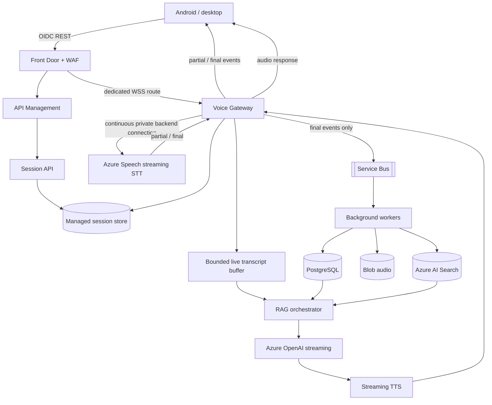
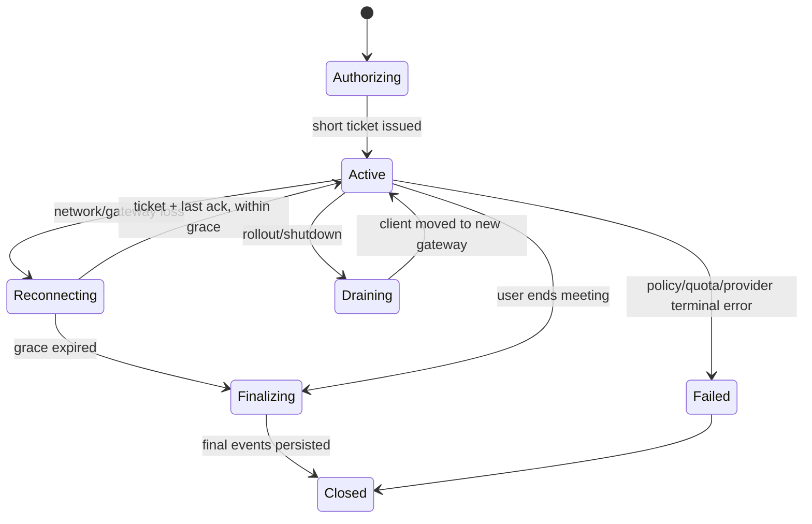

# NODO AI - real-time voice architecture

Status: designed 24 October 2026; the gateway, protocol, session recovery, Redis store and speech
adapters were implemented and tested on 29 October 2026 (section 10). The Azure resources that host
it and the live Azure Speech path are not deployed or proven. This extends the existing batch/async
architecture; the async path stays the source of durable processing.

## 1. Honest score and scope

| Capability | 24 Oct | Now | Target |
|---|---:|---:|---:|
| Completed-recording meeting intelligence | 8/10 on paper; Azure still unproven | 8/10 | 9/10 after live Azure/load/DR evidence |
| Live meeting transcription | 5/10 | 6.5/10 | 8.5/10 after Azure streaming and recovery evidence |
| Interactive speech-to-speech assistant | 3/10 | 6/10 | 8.5/10 after VAD, live TTS and barge-in evidence |

What moved the two lower rows: the streaming gateway, the resume protocol, the Redis session store
and the push-to-talk turn with cancellation now exist as code with tests, a real Redis and a
120-session load run. What keeps them from the target: none of it has run against Azure Speech,
Azure OpenAI or Azure Redis, the Azure resources for it are not in Terraform yet, there is no
client, and the LLM answer is not token-streamed.

The scores are architectural indicators, not measured product ratings. The async path remains the
source of durable processing. Real-time voice is a separate latency-sensitive path that feeds it.

## 2. Target topology



REST continues through API Management. A dedicated Front Door route reaches the Voice Gateway so
session duration, scaling, draining and backpressure policies do not contaminate normal API calls.
The gateway authenticates a short-lived, single-session ticket and rechecks workspace/meeting
authorization; it does not trust the edge as its only control.

Container Apps remains the first runtime choice. Its documented HTTP/TCP concurrency scaling is
enough for an initial WSS gateway; move the media plane to AKS or a managed media service only if
profiling proves a need for UDP/TURN, custom routing or finer connection draining.

## 3. Two modes, one session protocol

**Live Meeting Intelligence** continuously transcribes a meeting and publishes partial text to the
UI. Only finalized segments enter durable storage, indexing and extraction.

**Interactive Voice Assistant** begins with push-to-talk. A finalized question enters the existing
ACL-aware hybrid retrieval and answer path; LLM output is chunked at linguistic boundaries and sent
to streaming TTS. VAD/open-microphone activation comes later because a meeting utterance must not
accidentally become an assistant command.

Audio frames are binary, not Base64 in JSON. Control events are versioned JSON:

```json
{
  "type": "transcript.final",
  "protocol_version": 1,
  "session_id": "session-123",
  "event_id": "event-456",
  "sequence": 42,
  "audio_offset_start_ms": 12500,
  "audio_offset_end_ms": 14800,
  "speaker_id": "speaker_1",
  "text": "We should deploy next Monday."
}
```

`event_id` is the idempotency key. `sequence` detects loss/reordering. Audio offsets, not gateway
wall-clock timestamps, align transcript and replay. The client acknowledges the highest contiguous
event and keeps a bounded encrypted replay buffer (initial hypothesis: 20 seconds). Redis stores
leases, acknowledgements, routing and quota counters, and the finalized phrases of a live meeting
until they are handed over to the pipeline (they expire after six hours); it never stores audio.

## 4. Session lifecycle and recovery



Initial design values, to be replaced by measurement: two gateway replicas minimum, 25 active
sessions per replica, 15-second heartbeat, 30-second reconnect grace, 5-second server audio buffer,
20-second client replay. Active sessions are preserved under overload; admission closes before the
gateway exhausts memory, bandwidth or downstream quota.

A rolling deployment first stops admission, drains connections and asks clients to reconnect. The
session manager tracks the last acknowledged event so a new replica does not duplicate finalized
segments. If PostgreSQL is unavailable, the gateway keeps only a bounded encrypted spool according
to policy; it never allows unbounded memory/disk growth. Speech or LLM failure does not stop raw
recording: transcription may show degraded, and assistant answers may be temporarily unavailable.

## 5. Media-path decision

### Enterprise default: controlled WSS gateway

Client audio terminates at NODO's gateway, which holds the persistent Azure Speech SDK connection.
This preserves the existing private-service boundary and gives NODO full control of ACLs,
idempotency, observability and recording policy. It costs an extra media hop and gateway bandwidth.

### Optional: Voice Live WebRTC

Microsoft documents direct WebRTC media tracks for Voice Live, with WebSocket signaling and a data
channel for control/events. It brings codec, jitter and packet-loss handling and removes NODO from
the audio relay. Use it only after a formal decision on regional deployment, private connectivity,
tenant isolation, tool-call authorization and data residency. Do not assume that a direct mobile
WebRTC path satisfies the private-endpoint posture merely because the backend control plane is
private.

Speech + OpenAI + TTS remains the principal architecture because NODO needs deterministic,
ACL-aware retrieval and explicit durable meeting memory. Voice Live is an alternative for the
interactive mode, not a silent replacement of the meeting pipeline.

## 6. Capacity and current documented limits

Microsoft documentation checked on 24 October 2026 states:

- Azure Speech S0 real-time STT/translation defaults to 100 concurrent requests per resource and
  can be increased by request. Real-time diarization has a 240-minute session limit.
- Voice Live S0 defaults to 100 new connections/minute, at most 60 minutes per session and 120,000
  tokens/minute; new-connection/token quota is adjustable.
- Front Door Standard/Premium documents 3,000 concurrent global WebSocket connections per profile,
  a two-hour maximum connection, and closure after five idle minutes; higher connection limits need
  a support request.
- Container Apps can scale on concurrent HTTP requests or TCP connections, plus CPU/memory/custom
  metrics.

Sources: [Speech quotas and limits](https://learn.microsoft.com/azure/ai-services/speech-service/speech-services-quotas-and-limits),
[Front Door WebSocket behavior](https://learn.microsoft.com/azure/frontdoor/standard-premium/websocket),
[Front Door service limits](https://learn.microsoft.com/azure/azure-resource-manager/management/azure-subscription-service-limits),
[Container Apps scaling](https://learn.microsoft.com/azure/container-apps/scale-app), and
[Voice Live WebRTC](https://learn.microsoft.com/azure/ai-services/speech-service/voice-live-webrtc).

These are defaults/limits, not purchased capacity or a guarantee that a sharp burst will be
accepted. Admission uses the lower of approved Speech/Voice quota, model quota, gateway capacity
and Front Door capacity. Tests ramp gradually and treat 429 as a controlled capacity signal. A
1,000-session launch requires approved quota and observed headroom before traffic is admitted.

## 7. Interactive latency path

Instrument correlated monotonic timestamps at:

`capture -> gateway receive -> STT partial/final -> retrieval start/end -> first LLM token -> first TTS chunk -> client playback`

Initial SLOs:

| Measure | Target |
|---|---:|
| Partial transcript | p95 <= 1,000 ms |
| Final transcript after end of turn | p95 <= 2,000 ms |
| First response audio after question | p95 <= 2,000 ms |
| Barge-in to stopped playback | p95 <= 300 ms |
| Reconnect/resume | p95 <= 5,000 ms |
| Expected or recovered audio frames | >= 99.9% |
| Successful streaming sessions | >= 99.5% |

`tools/voice-bench/session_metrics.py` is the transport-independent quality gate for these metrics.

## 8. Android requirements

Use a microphone foreground service with the Android-version-specific service type and permissions.
The client owns acoustic echo cancellation, audio focus and the bounded replay buffer. Test screen
lock, background/foreground transitions, Wi-Fi/mobile handoff, incoming calls, Bluetooth route
changes, revoked permission, OS process death, simultaneous microphone/speaker use and battery
saver. Each test must prove both audio continuity and correct session cleanup.

## 9. Build order

1. Session API, short ticket, protocol schema and a WSS gateway that echoes validated frames.
2. Azure Speech continuous recognition, partial UI and idempotent final-segment persistence.
3. Reconnect/resume, Redis lease/ack state, admission control, draining and load/fault tests.
4. Push-to-talk assistant using the existing retrieval path, streaming LLM/TTS and cancellation.
5. VAD, semantic turn detection, barge-in and device echo cancellation.
6. Optional Voice Live/WebRTC experiment behind a separate feature flag and compliance gate.

The transition from an 8.5 to a 9 is an evidence milestone: cross-tenant isolation, continuity,
latency, cancellation, quota behavior, cost and regional recovery must all hold under sustained load.

## 10. Implementation status (29 October 2026)

Code is in `services/api/src/nodo_api/voice/`; the decisions are in docs/adr/028-voice-gateway.md.

| Piece | State |
|---|---|
| Session API, one-use ticket (first WebSocket message, not the URL), admission limits | Implemented, tested through the real app |
| Binary audio frames addressed by audio offset, versioned JSON events, sequence/ack/replay | Implemented, tested |
| WSS gateway: bounded send queue, heartbeat, idle timeout, audio rate budget, max duration | Implemented, tested |
| Reconnect on the same replica (replay of unacknowledged events) and on another one (resume from the last stored final) | Implemented, tested; the cross-replica path also on a real Redis |
| Redis session store: leases, admission counters, acknowledged offset, finals, one-use tickets | Implemented; the contract runs on memory and on Redis 7 (CI has a Redis service) |
| Rolling drain: stop admission, flush, hand clients to another replica | Implemented, load tested |
| Live meeting end: finals become transcript version 1 and the normal `transcribe` job | Implemented, tested end to end on the demo workspace |
| Push-to-talk assistant: same ACL-aware retrieval and validated answer, citations kept, spoken per sentence, barge-in | Implemented, tested |
| Azure Speech streaming recognition (diarized for meetings) and neural TTS | Written on the SDK, members checked against SDK 1.53 and constructed inside the production image; mapping tested with a stand-in. **Not run against a live resource** |
| Local push-to-talk on the Whisper path (no partials, no TTS) | Implemented, not exercised with the models in this change |
| Azure resources: Redis, the gateway app, the APIM WebSocket and session APIs (the edge route already carries them) | Terraform written behind `voice_enabled` and tested with mocked providers (`voice*.tf`, `tests/voice.tftest.hcl`); **never applied** |
| Android and web capture client, VAD, echo cancellation, semantic turn detection | **Not done** |
| Token-streamed LLM answers (the first audio waits for the whole answer) | **Not done** |
| Voice Live / WebRTC experiment | **Not done** (gated, step 6) |

### Measured here (gateway only)

`tools/voice-bench/gateway_load.py` runs two replicas of the real application, one Redis, 120
concurrent sessions per scenario, and feeds `session_metrics.py`. The speech provider is scripted
and the text-to-speech is a silent tone, so these numbers are the gateway's own cost on one
Windows laptop with the clients in the same process. Azure Speech and OpenAI add to every figure.

| Measure (120 sessions) | Live meeting + failover | Assistant | Target |
|---|---:|---:|---:|
| Partial transcript p95 | 61 ms | 69 ms | 1,000 ms |
| Final transcript p95 | 267 ms | 40 ms | 2,000 ms |
| First audio after the question p95 | - | 175 ms | 2,000 ms |
| Barge-in to stop p95 (60 sessions) | - | 147 ms | 300 ms |
| Reconnect / resume p95 | 1,726 ms (moved to the other replica) | 920 ms (same replica) | 5,000 ms |
| Audio continuity | 100% | 100% | 99.9% |
| Sessions leaving the exact transcript / answered | 120 / 120 | 120 / 120 | 99.5% |

Both runs pass the gate in `session_metrics.py` (the figures above are the last of several runs and move by tens of percent between runs on this machine; the gate passed in all of them). The meeting run loses 500 ms of audio in transit
for every session and moves all of them to the second replica in the middle of the stream; every
meeting ended with exactly the four phrases and no duplicate.

Two security review rounds (one by an independent reviewer) also changed the code: the lease, the
admission slot and the maximum duration are now kept by a server-side timer instead of the client's
ping; a failing store can not leak a session; one attach at a time per session; a per-user
admission cap; a cap on sockets that have not shown their ticket and a 64 KiB WebSocket frame
limit; bounded counters; `rediss://` required on Azure.

What the load run found (and fixed): the default Redis connection pool raised
`MaxConnectionsError` under 120 sessions, which stopped the drain from releasing 20 leases and made
those clients wait 33 s for the lease to lapse (the gate failed on reconnect p95). The store now uses
a blocking pool, and a failing store no longer stops a replica from forgetting a session it has
stopped serving.
