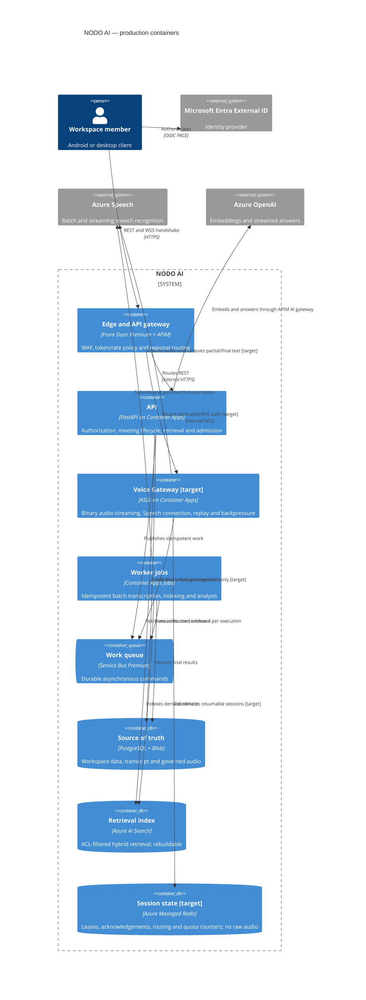

# C4 level 2 — production containers

Status: target architecture, 24 October 2026. Containers marked **target** are specified but not yet
implemented in the application or Terraform. Everything else has code and infrastructure definitions,
although no Azure subscription deployment has yet validated them.

The Voice Gateway is deliberately not part of the API process: a slow model, indexing task or REST
burst must not block audio receive loops. Redis is coordination state, never the durable transcript.
