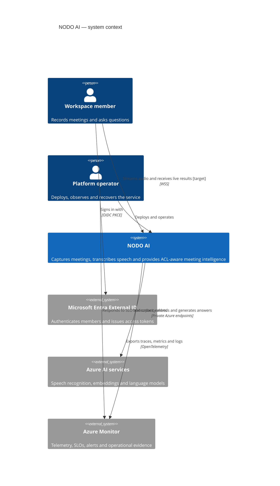

# C4 level 1 — system context

Status: target architecture, 24 October 2026. Solid relationships are in the current product or
Terraform; the real-time voice relationship is planned and remains behind an implementation gate.

The trust boundary is NODO AI. Azure AI never authorizes a workspace request: tenancy, ACLs,
admission and idempotency stay inside NODO.
