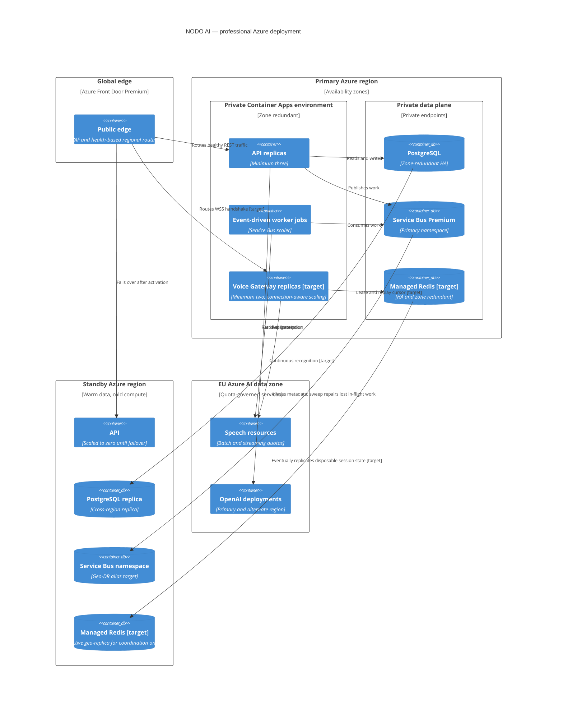

# C4 deployment — professional tier

Status: target deployment, 24 October 2026. The current Terraform implements the async resources.
Voice Gateway and Managed Redis are gated target nodes and must not be presented as deployed.

Admission uses the lowest available capacity across gateway sessions, approved Speech concurrency,
model quota and Front Door connections. The standby is not called active-active: database promotion
and an operator failover lever are required.
