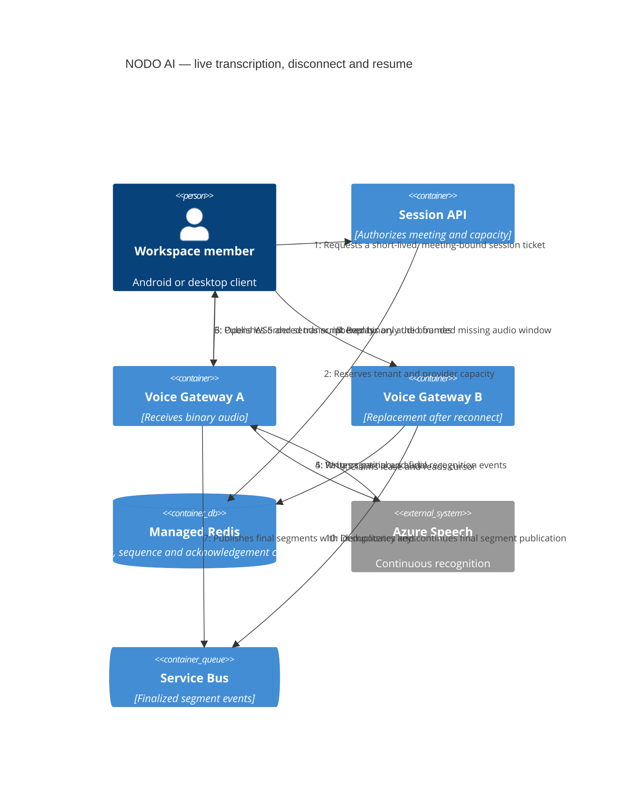

# C4 dynamic — resilient live transcription session

Status: target interaction, 24 October 2026. This is the acceptance contract for the Voice Gateway,
not a description of code that already exists.

Required invariants: an event id is durable and idempotent; partial text is replaceable; final text is
never indexed twice; active sessions survive admission closure; a reconnect outside the grace window
starts a new recognition epoch instead of pretending continuity.
