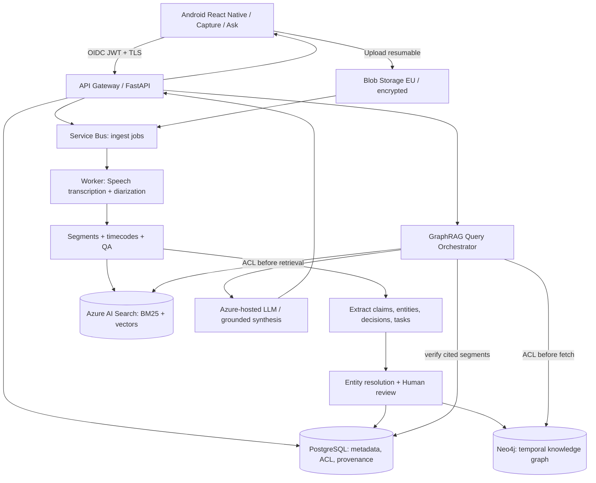

# NODO AI — Product Design & Solution Architecture

**Versione:** 0.1 · **Data:** 22 ottobre 2026 · **Target:** Android-first, uso personale, architettura estensibile enterprise  
**Stato:** Product blueprint e UX demo; nessun backend Azure o registrazione reale implementati.

## 1. Visione

**One-liner:** un assistente mobile privacy-first che acquisisce meeting autorizzati, li converte in una memoria temporale con fonti e Knowledge Graph e permette di interrogarli a voce o per testo.

**Jobs to be done:** «Dopo diversi meeting non ricordo chi ha proposto cosa, quando abbiamo cambiato una decisione e da quale conversazione proviene». NODO recupera il contesto senza inventare collegamenti non supportati e offre sempre l'evidenza originale.

**Target persona:** professionista tecnico che partecipa a meeting frequenti, gestisce progetti multipli e deve verificare decisioni, responsabilità e cambiamenti nel tempo.

**Non-obiettivi MVP:** intercettare chiamate o l'audio interno di altre app; registrare di nascosto; identificazione biometrica automatica degli speaker; invio automatico di messaggi/email; integrazione non autorizzata a sistemi aziendali; decisioni autonome ad alto impatto.

## 2. Esperienza utente

### Navigazione principale

| Schermata | Contenuto | Azione primaria |
|---|---|---|
| Home | Recenti, metriche personali, cambiamenti tra meeting | Nuova registrazione |
| Capture | Avviso partecipanti, autorizzazione microfono, timer, pausa, stop, stato offline | Registra |
| Meeting detail | Riassunto, speaker, trascrizione timestampata, decisioni, task, connessioni | Apri evidenza |
| Ask | Chat e interrogazione vocale; fonti cliccabili | Fai una domanda |
| Graph | Nodi e relazioni, filtri per progetto/persona/data, lineage delle decisioni | Esplora |
| Privacy | Retention, export, delete, access logs, gestione permessi e fonti | Gestisci dati |

### Journey desiderato

1. L'utente apre **Capture**, seleziona workspace e durata di conservazione, informa i partecipanti, verifica la base giuridica e la liceità della registrazione.
2. Accetta l'avviso applicabile e avvia volontariamente la registrazione. Android mostra indicatore e notifica persistente; l'audio viene scritto in file cifrati sul dispositivo.
3. L'utente può mettere in pausa, terminare o cancellare. In assenza di rete, l'audio rimane locale; alla riconnessione un uploader riprende dai blocchi mancanti.
4. Il server trascrive e identifica **speaker anonimi** (`S1`, `S2`). Un partecipante può ricevere un nome solo su assegnazione esplicita: la diarization non equivale a identificazione personale.
5. L'AI propone summary, `Decision`, `ActionItem`, `Claim` e `Entity` con evidenze. L'utente può correggere/approvare nomi, decisioni e relazioni ambigue.
6. Gli oggetti approvati entrano nella memoria e nei relativi indici; query successive ricostruiscono connessioni e cambiamenti cronologici.
7. Quando l'utente interroga la memoria, ogni affermazione sostanziale viene accompagnata da `meeting_id`, `segment_id`, timestamp e testo di supporto; se non c'è evidenza, il prodotto dichiara il limite.

### Esempio di UX di risposta

**Utente:** «Che cosa è cambiato nella pipeline di ingestion?»  
**NODO:** «Il 7 ottobre si valutava un flusso sincrono; il 21 ottobre il team ha scelto una coda asincrona per assorbire i picchi. Sara prepara un benchmark entro il 28 ottobre».  
**Fonti:** `[7 ott, 18:03]` e `[21 ott, 12:42]`, `[21 ott, 28:15]`.  
**Note:** nell'UX demo tutti i contenuti sono inventati; il backend reale non esiste ancora.

### Principi visuali

Interfaccia dark, contrasto alto, accento turchese, navigazione a quattro tab, call-to-action di registrazione ben riconoscibile, dettaglio fonte a un tap. Non nascondere mai stato di registrazione o insufficienza di prove. Le visualizzazioni grafiche sono **secondarie** rispetto alla lista accessibile di entità/relazioni: un grafo solo visivo è poco fruibile su mobile e per screen reader.

## 3. Stack tecnologico raccomandato

| Layer | Scelta MVP | Produzione / motivazione |
|---|---|---|
| Android | React Native + TypeScript, Expo development build + native module dove necessario | React Native sfrutta competenze React/JS; registrazione affidabile e servizi foreground gestiti nativamente |
| Mic & storage | Android `RECORD_AUDIO`, `FOREGROUND_SERVICE_MICROPHONE`, notifica visibile, Android Keystore + cifratura at-rest | Foreground service avviato da attività visibile; upload resumable, controllo batteria/offline |
| API | Python FastAPI, Pydantic v2, OpenAPI, JWT validation | API stateless, versionamento `/v1`, idempotency key |
| Auth | Microsoft Entra External ID / OIDC Authorization Code + PKCE | Access token short-lived, refresh token protetto, user/workspace RBAC |
| Audio STT | Azure AI Speech, diarization dove supportata, batch finale | Real-time preview opzionale: transcript finale verificabile come source of truth |
| LLM / TTS | Modelli ospitati su Azure AI Foundry/Azure OpenAI con deployment regionale da verificare, Azure Speech TTS | Provider adapter; output strutturato validato; niente chiavi sul device |
| Pipeline | Azure Service Bus, Container Apps Jobs/Workers | At-least-once + idempotenza; DLQ, retries, backpressure |
| Blob | Azure Blob Storage, private container, customer-managed keys quando necessario | Lifecycle rules, expiring SAS generate lato backend, backup e tombstones |
| Metadati | Azure Database for PostgreSQL Flexible Server | Dati transazionali, sessioni, provenance, ACL, outbox |
| Semantic retrieval | Azure AI Search (BM25 + dense + RRF + semantic ranker) | Index tenant/workspace-aware; filtri accesso **pre-retrieval** |
| Graph | Neo4j AuraDB su Azure se rete/contratti idonei, o Neo4j self-hosted | Cypher e pattern temporali; controllare region, costi, private networking, cancellazione |
| Orchestrazione agentica | LangGraph solo per il ramo `query planner → tools → evidence → answer` | Policy deterministiche e tool contracts stretti; no agent libero nell'MVP |
| MCP | Gateway interno e tool read-only: `search_meetings`, `get_transcript`, `lookup_entity`, `traverse_graph` | Per integrazioni future, OAuth/OIDC, RBAC e audit per tool |
| Hosting | Azure Container Apps per API, workers, gateway | AKS solo quando SLO, isolamento o scala lo giustificano |
| Infrastruttura | Terraform + GitHub Actions + Azure Container Registry | CI test, SAST, image signing/scanning, approvazioni production |
| Telemetria | OpenTelemetry + Azure Monitor/Application Insights | Correlation IDs; tracce con redazione PII; metriche di qualità AI |

**Nota:** Next.js non è il framework della UI Android; usarlo in futuro per una console web opzionale. Svelte/Flask sono alternative, non componenti necessari per forza. Per un'app solo Android Kotlin + Jetpack Compose può offrire miglior controllo sui servizi audio, ma React Native soddisfa meglio l'obiettivo full-stack JS/Python/Azure.

## 4. Architettura logica



**Confini di fiducia:** device ↔ public API; API ↔ private VNet; managed services con private endpoint ove disponibile; separazione di IAM per ingestion e query. Event Bus/queue **non** trasporta dati audio in chiaro ma riferimenti autenticati agli oggetti.

**Ambiente POC:** Docker Compose con `FastAPI`, `PostgreSQL + pgvector`, `Neo4j`, `Redis`/worker e storage S3-compatible locale; adapter mocked per Speech/LLM. **Produzione:** Azure Container Apps inizialmente, quindi AKS con Helm/Kustomize solo se richiesto, gestione deployment canary/rollback.

## 5. GraphRAG: data contract e pipeline

### Modello dati

- `Meeting(id, workspace_id, owner_id, started_at, duration_ms, state, legal_notice_version, retention_until, source_hash)`
- `TranscriptSegment(id, meeting_id, speaker_id, t_start_ms, t_end_ms, text, confidence, version, access_scope)`
- `Speaker(id, meeting_id, anon_label, confirmed_person_id?)` — per default nessun riconoscimento biometrico.
- `Entity(id, workspace_id, type, canonical_name, aliases, reviewed)` con tipi `Person`, `Project`, `System`, `Topic`.
- `Decision(id, workspace_id, statement, status, effective_at, supersedes_id?, confidence, reviewed)`.
- `ActionItem(id, statement, owner_id?, due_at?, status, reviewed)`.
- `Claim(id, subject_id, predicate, object_id?, asserted_at, valid_from?, valid_to?, meeting_id, segment_id, extraction_version, confidence, verification_status)`.
- `Evidence(id, source_segment_id, extraction_id, relation_id?, quote_start_ms, quote_end_ms)`.

### Relazioni del grafo

`MENTIONED_IN`, `DISCUSSED_WITH`, `ABOUT_PROJECT`, `PROPOSED_BY`, `DECIDED_IN`, `ASSIGNED_TO`, `DEPENDS_ON`, `SUPERSEDES`, `SUPPORTED_BY`, `CONTRADICTS`. Le relazioni includono workspace, timestamp, source evidence e versione. Ogni relazione significativa deve conservare una provenienza che renda possibile audit e cancellazione cascata.

### Pipeline ingest

`Audio → STT → quality checks → diarization → speaker correction → time/semantic segmentation → structured extraction → schema validation → entity resolution → human review on ambiguous data → upsert idempotent → indexes → readiness state`.

Implementare `source_hash + pipeline_version + event_id` per idempotenza. Mantenere il transcript originale immutabile a versioni; le correzioni generano una nuova versione. Non creare automaticamente un collegamento tra due persone solo perché condividono un nome comune. Un estratto LLM non confermato non diventa una decisione ufficiale.

### Query path

1. Autenticare utente; calcolare `workspace_id` e permessi effettivi.
2. Interpretare intent, time range, entità e vincoli temporali.
3. Avviare **in parallelo** hybrid retrieval e lookup del grafo, con filtri `workspace_id`, ownership/ACL in ogni strato, non dopo aver recuperato dati altrui.
4. Limitare graph traversal a 1–2 hop per default e imporre massimi di nodi, profondità, timeout e budget token.
5. Recuperare segmenti originali per ogni claim/relazione, applicare reranking, controllo temporale e diversificazione dei meeting.
6. Sottoporre al modello solo evidenze autorizzate, con metadati e delimitatori per prompt-injection resistance.
7. Validare la risposta: tutte le citazioni rimandano a segmenti recuperati; affermazioni critiche senza fonte sono rimosse o marcate come non verificate.
8. Generare risposta testo; TTS solo su esplicita richiesta. Aprire la fonte dal timestamp appropriato.

**Esempio Cypher** (schema indicativo, non pronto a eseguire senza DDL):

```cypher
MATCH (d:Decision {workspace_id:$workspace})-[:ABOUT]->(p:Project {id:$project_id})
WHERE d.effective_at >= datetime($from) AND d.effective_at <= datetime($to)
OPTIONAL MATCH (d)-[:SUPERSEDES]->(previous:Decision)
OPTIONAL MATCH (d)-[:SUPPORTED_BY]->(s:TranscriptSegment)
RETURN d, previous, collect(DISTINCT s) AS evidence
ORDER BY d.effective_at DESC
LIMIT 20
```

**Fondamentale:** i nodi del grafo non sono autonomamente affidabili; prove e accesso ai segmenti **devono** essere verificati nel livello applicativo e negli indici autorizzati prima che una relazione venga mostrata al modello.

## 6. API contract (v1, proposta)

| Method | Path | Semantica |
|---|---|---|
| POST | `/v1/meetings` | Crea meeting con policy/retention e `Idempotency-Key` |
| POST | `/v1/meetings/{id}/upload-sessions` | Avvia upload autenticato a blocchi e restituisce URL limitate nel tempo |
| POST | `/v1/meetings/{id}/complete` | Finalizza l'upload; pubblica job di trascrizione una sola volta |
| GET | `/v1/meetings/{id}` | Stato `uploading / transcribing / extracting / review / ready / failed` |
| GET | `/v1/meetings/{id}/transcript` | Segmenti con speaker e timecode, paginati |
| PATCH | `/v1/meetings/{id}/review` | Correzioni e approvazioni versionate |
| POST | `/v1/query` | Query GraphRAG testuale con `filters` e citations obbligatorie |
| POST | `/v1/voice-query` | STT della domanda, stessa pipeline di query, TTS opzionale |
| GET | `/v1/graph/subgraph` | Sottografo autorizzato per entità, range e profondità |
| POST | `/v1/export` | Esportazione dati dell'utente, job asincrono |
| DELETE | `/v1/meetings/{id}` | Tombstone + erase cascade nei sistemi indicizzati, rispettando gli obblighi applicabili |

Query response (esempio del **contratto**, contenuti fittizi):

```json
{
  "answer": "Il 21 ottobre è stata scelta una coda asincrona.",
  "answerability": "supported",
  "citations": [{"meeting_id":"m1","segment_id":"seg-024","start_ms":762000,"end_ms":770000,"quote":"..."}],
  "related_entities": ["ingestion", "async-queue"],
  "query_trace_id": "example-trace-id",
  "model_version": "deployment-version",
  "retrieval_version": "hybrid-graph-v1"
}
```

Risposte `unanswerable` non devono ricevere citazioni inventate. Non esporre raw chain-of-thought, segreti o log PII.

## 7. Android audio: requisiti non negoziabili

- Avvio registrazione **sempre esplicito** da UI visibile. Richiedere permesso `RECORD_AUDIO` e foreground service `microphone` con notifica persistente secondo target Android.
- Scrivere blocchi locali cifrati e finalizzare con manifest, SHA-256, sequence number, durata, stato ACK. Recuperare upload dopo kill/network loss.
- Non assumere che il microfono possa leggere direttamente l'audio interno di Teams/Meet/altre app; il prodotto registra l'ambiente se permesso dal sistema e dalle persone.
- Interruzioni di chiamata, revoca permessi, low battery e spazio insufficiente: stop/pause controllati, dati coerenti, stato esplicito; nessuna registrazione invisibile.
- Trascrizione live opzionale; la trascrizione finale batch deve poter correggere gli speaker, mantenendo traccia di correzioni/versioni.

## 8. Sicurezza, privacy e accountability

### Checkpoint di design

- **Legal gate:** il proprietario del prodotto deve valutare applicabilità del GDPR e la propria qualifica di titolare/responsabile del trattamento, base giuridica, informativa, norme locali e policy dei meeting. «Solo uso personale» non rende automaticamente l'attività fuori dal GDPR, soprattutto in contesti professionali.
- **No blanket waiver:** una spunta «l'utente si assume ogni responsabilità» **non trasferisce automaticamente** obblighi legali del gestore né sostituisce informativa agli interessati o base giuridica.
- **Participant notice:** messaggio semplice prima dell'avvio, visibilità della registrazione, possibilità di non registrare, gestione contestazioni e contesto lavorativo.
- **Data minimization:** retention configurabile (proposta default 30 giorni per audio; transcript e grafo con policy separate); export/delete e cancellazione downstream; pseudonimi speaker per default.
- **Data locality:** scegliere region EU supportate per tutte le risorse e verificare processing, storage, abuse monitoring e contratti del *deployment specifico*; evitare deployment Global quando la policy richiede vincoli più stretti.
- **Security:** TLS, mTLS/service identity interni quando sensato, RBAC/ABAC, managed identity, Key Vault, backup cifrati, private endpoints, network segmentation, WAF/rate limits, audit eventi senza contenuti sensibili.
- **LLM:** tool allowlists, ingress sanitation, schema validation, prompt-injection tests, no cross-tenant knowledge, human review su estrazioni sensibili, redazione PII nei log.
- **Governance:** ROPA/DPIA dove richiesta, retention/disposal, DSAR, DPA fornitori cloud, breach playbook, controllo autorizzazioni aziendali prima di acquisire meeting lavorativi.

### Testo UX suggerito: avviso prima della registrazione

> Questa funzione registra audio e, se abilitato, genera trascrizioni e informazioni collegate tramite servizi AI. Prima di avviarla, informa tutte le persone coinvolte e verifica che registrazione e trattamento siano consentiti dalla legge, dalle regole del luogo di lavoro e dalle eventuali autorizzazioni necessarie. Puoi interrompere la registrazione in qualsiasi momento. I dati vengono trattati secondo l'informativa privacy e le impostazioni di conservazione.

Checkbox proposta: «Confermo di aver informato i partecipanti e di avere verificato di poter registrare in questo contesto». **Questa dichiarazione documenta una presa visione dell'utente; non crea automaticamente una base giuridica, né prova che i partecipanti abbiano acconsentito.** Prevedere un meccanismo verificabile di notice/consenso ove richiesto dalla legge e distinguere da accettazione Terms e privacy notice.

### Firma / attestazione del responsabile della registrazione

Per il caso d'uso personale prevedere una **attestazione per singolo meeting**, distinta dall'accettazione generale dei Terms: `user_id`, `meeting_id`, `notice_version`, `acknowledged_at`, `retention_policy_id`, `locale` e `audit_event_id` firmato lato server (integrità tramite HMAC o firma digitale del record). Si tratta di **prova della dichiarazione dell'utente**, non di prova del consenso effettivo dei partecipanti. Se il contesto richiede l'assenso dei partecipanti, offrire una procedura separata e verificabile (per esempio invito/QR con informativa e risposta registrata), alternativa "non registrare" e possibilità di revoca o richiesta secondo la base giuridica. Evitare raccolta di firme biometriche non necessarie.

Non raccogliere firme come meccanismo fittizio di trasferimento universale della responsabilità. Il gestore deve mantenere privacy notice, incident response, controlli accesso e obblighi applicabili.

### Termini d'uso: responsabilità dell'utente — bozza da revisione legale

> L'utente è tenuto a utilizzare la funzione di registrazione solo quando dispone dei diritti e delle autorizzazioni necessari, a rispettare la normativa applicabile e i regolamenti del luogo di lavoro, e a non acquisire informazioni di terzi in modo illecito. Il gestore del servizio applica le misure di protezione dei dati previste dalla propria informativa e dalla normativa applicabile. Nessuna clausola intende escludere responsabilità che non possano essere legalmente escluse.

La validità dei termini dipende da ruolo giuridico, giurisdizione, contesto d'uso e modalità concrete del servizio; occorre revisione legale prima della distribuzione.

**Riferimenti verificabili:**
- Datatilsynet DK, registrazioni: https://www.datatilsynet.dk/regler-og-vejledning/optagelser-og-tv-overvaagning
- GDPR: https://eur-lex.europa.eu/eli/reg/2016/679/oj/eng
- EDPB: https://www.edpb.europa.eu/
- Azure DPIA: https://learn.microsoft.com/en-us/compliance/regulatory/gdpr-dpia-azure
- Android microphone service: https://developer.android.com/about/versions/14/changes/fgs-types-required
- Azure Speech diarization: https://learn.microsoft.com/en-us/azure/ai-services/speech-service/get-started-stt-diarization
- Azure AI Search hybrid: https://learn.microsoft.com/en-us/azure/search/hybrid-search-how-to-query

## 9. MVP e roadmap

### Sprint 0 — Foundation (1–2 settimane)

Monorepo, design system, Dev Container, threat model, data contracts, baseline CI, Terraform minimal, mocked dependencies, 6 schermate UX, Android device testing.

### Sprint 1 — Capture & durable sync (1–2 settimane)

Permessi Android, foreground recording visibile, cifratura locale, session upload resumable, meeting state machine, policy check, error handling. **Exit:** registrazione 60 minuti con rete intermittente non perde blocchi.

### Sprint 2 — STT + extraction (1–2 settimane)

Speech batch/diarization, transcript speaker/timecode, structured extraction, correction UI, Postgres, quality/versioning. **Exit:** riapertura meeting con timecode e speaker rivedibili.

### Sprint 3 — Graph + retrieval (1–2 settimane)

Ontology, Neo4j, hybrid index, ACL pre-retrieval, deterministic query planner, grounded citation UI, evidence validator. **Exit:** domanda cross-meeting risolta con fonti e corretta sequenza temporale.

### Sprint 4 — Voice Q&A + hardening (1–2 settimane)

Domande vocali, TTS opzionale, security testing, guardrails, E2E Android, cost/latency instrumentation, delete/export, runbook and alerts. **Exit:** ready for a small controlled private beta, non per uso lavorativo non autorizzato.

Tempi stimati indicativi per 1 persona competente, non un impegno di delivery.

### Prima release / fuori perimetro

Calendar/Teams integration (solo tramite API ufficiali e permessi), meeting pre-brief, reminder con consenso, multimodal RAG su allegati, merge di grafi, collaborazione multiutente, fully private/on-prem mode. Non iniziare con tutto questo.

## 10. KPI, SLO ed evaluation

**Requisiti proposti, da validare sperimentalmente**:

| Misura | Target beta |
|---|---|
| Integrità upload | 100% blocchi ACK o recovery esplicito; nessuna perdita silenziosa |
| Precisione citazioni | ≥95% citazioni verificabili a segmento/timecode |
| Answer faithfulness | ≥95% su golden set annotato |
| Cross-meeting fact accuracy | ≥90% su casi con variazioni temporali |
| Speaker attribution accuracy | Misurare DER / speaker confusion su audio rumoroso; nessuna attribuzione personale automatica |
| Query latency p95 | ≤8 s per risposta testuale non streaming, prima dell'eventuale TTS |
| Ingest availability | Queue retries, DLQ visibile, job idempotenti |
| Authorization | 0 fughe cross-workspace in suite di ACL-negative test |
| Cancellazione | Test che audio, metadata, vector chunks e graph edges non siano più recuperabili quando richiesto |
| Cost | EUR/ora audio, EUR/100 queries, storage/retention, compute idle |

**Golden set iniziale (minimo 100–200 query):** single-meeting facts, cambio decisioni, speaker ambigui, multilingual IT/EN, incomplete references, queries senza risposta, entity collisions, false cross-project joins, ACL negatives, canceled/deleted data. Misurare su fixture stabilizzate e report versionati in CI.

**Observability:** p50/p95 STT, time to first transcript, ingestion queue age, transcript confidence, graph upsert conflicts, retrieved source count, answerability rate, groundedness score, token/cost breakdown, Azure service throttles, app crash-free sessions, failure rate offline upload.

## 11. Repository suggerito

```text
nodo-ai/
  apps/android/                  # React Native TypeScript
  services/api/                 # FastAPI + OIDC + rate limiting
  services/ingestion-worker/    # Speech transcription & extraction
  services/graphrag/            # retrieval, Cypher, citations, evaluation
  packages/contracts/           # OpenAPI, JSON schema, shared types
  infra/terraform/              # Azure Container Apps, Bus, Search, DB...
  infra/compose/                # POC Postgres/Neo4j/MinIO
  eval/golden_set/              # provenance/ACL/cross-meeting cases
  docs/adr/                     # architecture decision records
  .github/workflows/            # unit, SAST, build, scan, release
```

**ADR 001:** React Native + native foreground recorder su Android.  
**ADR 002:** Event-driven ingestion con separazione tra preview STT e transcript finale.  
**ADR 003:** Hybrid Azure AI Search + graph traversal, tutte le fonti enforce ACL.  
**ADR 004:** Relazioni temporali con `SUPPORTED_BY` e human approval on ambiguity.  
**ADR 005:** Distinguere acknowledgement utente, base giuridica del trattamento e obblighi del gestore.

## 12. Cosa rappresenta la demo allegata

`NODO_UX_Demo.html` è un **prototipo HTML interattivo standalone** che funziona nel browser anche senza internet. I meeting e le trascrizioni sono inventati; non attiva microfono, non salva audio e non effettua chiamate Azure. È utile per validare navigazione, CTA, citazioni, vista graph, privacy settings, user journey e presentazione del concept. **Non è una vera app Android e non è production-ready.**
